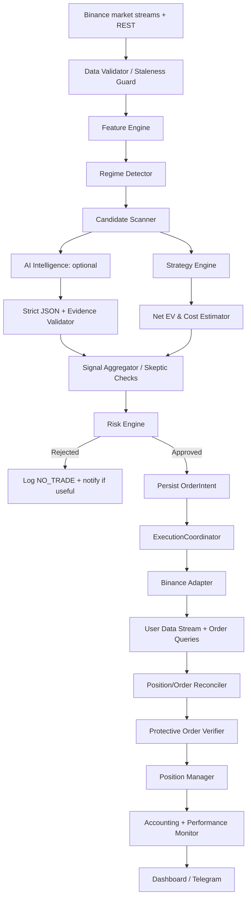

# ASTRA TRADER V5.1
## Bản đặc tả kiến trúc, chức năng, thuật toán, giao tiếp và vận hành cho ứng dụng giao dịch tự động trên Android

**Phiên bản đặc tả:** 5.1  
**Ngày chốt thiết kế:** 29-10-2026  
**Nền tảng mục tiêu:** Samsung Galaxy S7 Edge, LineageOS 18.1 / Android 11, RAM 4 GB, bộ nhớ trong 64 GB  
**Công cụ tạo ứng dụng:** Google AI Studio, chế độ tạo ứng dụng Android native  
**Ngôn ngữ/khung giao diện:** Kotlin, Jetpack Compose, Material 3  
**Sàn mục tiêu của phiên bản đầu:** Binance USDⓈ-M Futures  
**Vốn khởi điểm do người dùng nhập:** 150.000 VNĐ, giá trị USDT thực tế phải lấy từ tài khoản và tỷ giá tại thời điểm chạy  
**Mục đích:** thiết kế một bot giao dịch tự động có thể hoạt động với tài khoản thật khi người dùng chủ động kích hoạt, lấy dữ liệu thị trường, đánh giá cơ hội, kiểm soát rủi ro, gửi và quản lý lệnh, đối soát kết quả, báo cáo bằng tiếng Việt qua ứng dụng và Telegram.

## GHI CHÚ PHIÊN BẢN 5.1 · BỔ SUNG THƯ VIỆN THUẬT TOÁN VÀ AI

Bản 5.1 mở rộng danh mục phương pháp có thể áp dụng cho Astra Trader: toán học/xác suất/thống kê, đặc trưng giá, cấu trúc thị trường, dòng lệnh, mô hình dự báo, tin tức/NLP/tâm lý đám đông, AI nhẹ/nặng, bộ phản biện, quản trị vốn, thực thi và kiểm định. Các bổ sung được chia thành ba trạng thái: **V1 BASELINE** (phù hợp để triển khai trong phạm vi hiện tại), **OPTIONAL AFTER VALIDATION** (chỉ bật sau khi có dữ liệu và kiểm định), và **RESEARCH ONLY / OUT OF V1** (không triển khai trong bản đầu).

**Quy tắc ưu tiên:** các phần bổ sung trong bản 5.1 không hủy bỏ giới hạn v1 đã chốt ở mục 1.3, không tự động bật nhiều chiến lược, không đổi phần cứng mục tiêu, không cho AI quyền gửi lệnh và không biến danh mục thuật toán thành cam kết rằng mọi phương pháp đều có lợi thế. Nếu phụ lục mới có vẻ mâu thuẫn với các tiên đề bất biến ở mục 2, tiên đề bất biến và các cổng Risk/Execution vẫn có hiệu lực.

> **Nguyên tắc nền tảng:** mục tiêu tối ưu là lợi nhuận kỳ vọng ròng sau phí trong giới hạn rủi ro đã đặt, không phải tối đa số lệnh, tỷ lệ thắng trên backtest, số lượng AI hay mức đòn bẩy. Không mô hình nào bảo đảm lợi nhuận. Khi không chứng minh được một lệnh phù hợp với vốn, chi phí, dữ liệu và rủi ro, kết quả hợp lệ là `NO_TRADE`.

---

# 0. HƯỚNG DẪN CHO AI TẠO ỨNG DỤNG

AI triển khai phải coi toàn bộ đặc tả này là yêu cầu sản phẩm và hợp đồng kỹ thuật. Không chỉ tạo giao diện giả, dữ liệu demo hoặc vài màn hình bấm được. Phải tạo một dự án Android native bằng Kotlin và Jetpack Compose có cấu trúc rõ ràng, build được, có xử lý lỗi, lưu trạng thái và các lớp tích hợp được tách biệt.

## 0.1. Yêu cầu bắt buộc đối với bản code sinh ra

1. Tạo ứng dụng Android native, không thay bằng website/PWA.
2. Giữ tương thích Android 11 (API 30) trên thiết bị mục tiêu; các API chỉ có ở Android mới phải có kiểm tra phiên bản và đường dự phòng.
3. Dùng Jetpack Compose cho UI, Kotlin Coroutines/Flow cho tác vụ bất đồng bộ, Room cho dữ liệu bền vững và Android Keystore để bảo vệ khóa mã hóa.
4. Chọn thư viện mạng phù hợp và chỉ dùng một ngăn xếp HTTP/WebSocket chính. Không tự tạo nhiều client trùng chức năng.
5. Mọi endpoint, tham số, loại lệnh, bộ lọc và trường dữ liệu Binance phải được kiểm tra theo API reference hiện hành khi triển khai. Không bịa endpoint hoặc dựa vào ví dụ lỗi thời.
6. Mọi lệnh giao dịch phải đi qua một `ExecutionCoordinator` duy nhất, sau khi được `RiskEngine` chấp thuận. Không mô-đun AI, giao diện hay Telegram nào được gửi lệnh trực tiếp.
7. Không đưa API secret vào log, crash report, analytics, prompt AI hoặc tin nhắn Telegram. Không để lộ bí mật trong mã nguồn, tệp cấu hình mặc định, dữ liệu demo hay bản build phát hành.
8. Không dùng kết quả AI tự do làm lệnh. AI chỉ trả cấu trúc dữ liệu có schema; bộ kiểm định độc lập xác minh lại toàn bộ trường trước khi sử dụng.
9. Không tạo ra tính năng “AI local chuyên ngành” bằng trọng số giả, xác suất bịa hoặc tên mô hình tự đặt. Nếu chưa có mô hình thật được huấn luyện và kiểm định, phải dùng baseline xác định hoặc bỏ qua mô-đun đó.
10. Không tuyên bố app “bất tử”, “chạy 24/7 chắc chắn”, “SL không thể lỗi”, “đã bảo đảm hòa vốn” hoặc “tăng lợi nhuận chắc chắn”. Phải thể hiện rõ rủi ro mất mạng, hệ điều hành dừng tiến trình, lệnh bị từ chối và trượt giá.
11. Không tự tăng khối lượng hoặc đòn bẩy chỉ để vượt mức lệnh tối thiểu. Nếu mức lệnh tối thiểu không đáp ứng giới hạn rủi ro, từ chối lệnh.
12. Không tự chuyển sang giao dịch bằng mô hình local chưa được kiểm định khi tất cả API AI ngoài lỗi. Chế độ dự phòng mặc định là không mở vị thế mới, tiếp tục giám sát và bảo vệ vị thế hiện có bằng các lệnh phía sàn đã được xác minh.
13. Không nhét LLM cỡ lớn vào S7 Edge RAM 4 GB. AI phân tích ngôn ngữ dùng API ngoài theo cấu hình; các phép tính tức thời chạy bằng Kotlin và thuật toán định lượng nhẹ.
14. Các chức năng thật phải được đánh dấu là `IMPLEMENTED`, `PARTIAL` hoặc `NOT_IMPLEMENTED`. Không để nút giao diện giả vờ thành công khi không có backend/API thật.
15. Viết unit test cho phép tính vốn, bộ lọc giá/khối lượng, parser JSON, state machine, bộ chống lệnh trùng, tính PnL và các trường hợp mạng thất bại.
16. Giữ một chế độ kiểm thử và một chế độ LIVE tách biệt. LIVE chỉ được kích hoạt bằng thao tác xác nhận tường minh của người dùng sau các kiểm tra sẵn sàng.

## 0.2. Phạm vi thực tế của Google AI Studio và app chạy trên điện thoại

Ứng dụng Android native sinh ra là chương trình chạy phía thiết bị. Không mặc định có một máy chủ nền bí mật đi kèm app. Các cuộc gọi đến Binance, nhà cung cấp AI và Telegram phải được thực hiện từ thiết bị hoặc qua một backend riêng nếu người dùng chủ động bổ sung backend sau này.

- Nếu ứng dụng và tiến trình của nó bị dừng, không có backend riêng thì bot không thể xử lý lệnh Telegram, quét thị trường hoặc đưa ra quyết định mới cho tới khi chạy lại.
- Các lệnh bảo vệ đã được Binance chấp nhận và lưu ở phía sàn có thể tiếp tục tồn tại khi điện thoại mất mạng, nhưng phải xác minh trạng thái thật của từng lệnh.
- Tích hợp Gemini nên dùng cơ chế phù hợp của nền tảng Android như Firebase AI Logic/App Check khi đáp ứng được yêu cầu. Với API của nhà cung cấp khác, không thể giả định có lớp bí mật phía máy chủ trong APK.
- Dự án chỉ có thể được coi là build thành công sau khi thực sự biên dịch và kiểm thử. Việc AI tạo ra mã nguồn không chứng minh mã ấy đúng.

---

# 1. MỤC TIÊU, PHẠM VI VÀ CÁC GIỚI HẠN BẤT BIẾN

## 1.1. Mục tiêu sản phẩm

Astra Trader là ứng dụng cá nhân cho phép:

- Kết nối tài khoản Binance USDⓈ-M Futures bằng API key do người dùng tự tạo.
- Lấy dữ liệu giá, nến, khối lượng, funding, OI và sổ lệnh ở mức phù hợp với giới hạn API và năng lực thiết bị.
- Tạo danh sách ứng viên giao dịch; xếp hạng cơ hội bằng đặc trưng định lượng, trạng thái thị trường và thông tin AI khi có ích.
- Tính lợi thế kỳ vọng sau phí, mức lỗ dự kiến, khối lượng và yêu cầu ký quỹ.
- Quyết định `TRADE_CANDIDATE`, `NO_TRADE`, `PAUSE` hoặc `MANAGE_POSITION`; không coi AI là bộ thực thi.
- Gửi lệnh thật khi LIVE được bật và mọi cổng kiểm soát đều đạt.
- Đặt lệnh bảo vệ phía Binance ngay sau khi phát sinh vị thế, xác minh khớp lệnh và dọn các lệnh bảo vệ dư khi vị thế về 0.
- Quản lý một vị thế do bot sở hữu tại một thời điểm trong phiên bản đầu.
- Dừng tìm cơ hội mới, chờ vị thế đóng rồi chuyển sang trạng thái chờ người dùng nạp/rút tiền.
- Gửi thông báo trạng thái, giao dịch và sự cố bằng tiếng Việt qua Telegram.
- Ghi lại lý do, số liệu, phiên bản cấu hình và kết quả để tái dựng quyết định.

## 1.2. Không cam kết

Hệ thống không cam kết lợi nhuận, tỷ lệ thắng, thời gian hoàn vốn, mức drawdown tối đa tuyệt đối, uptime 100%, khớp lệnh ở giá kỳ vọng hoặc khả năng thoát lệnh trong mọi sự cố. Các lệnh stop-market cũng có thể bị trượt giá; lệnh phía sàn có thể bị từ chối, hết hạn hoặc không được tạo nếu cấu hình/điều kiện sai.

Mục tiêu “tăng tối đa tính chính xác để tăng lợi nhuận” được cụ thể hóa thành:

1. Tăng chất lượng và tính đúng thời điểm của dữ liệu.
2. Giảm lỗi tính toán, rò rỉ dữ liệu và lỗi trạng thái lệnh.
3. Đo xác suất dự báo bằng dữ liệu ngoài mẫu, kiểm định hiệu chuẩn và đánh giá sau chi phí.
4. Không giao dịch khi lợi thế chưa vượt chi phí và biên bất định.
5. Kiểm soát mức lỗ, đòn bẩy, thanh khoản và mức phơi nhiễm.
6. Dừng chiến lược khi hiệu năng suy giảm.

Đây là mục tiêu kỹ thuật có thể đo lường, không phải lời hứa lợi nhuận.

## 1.3. Phạm vi phiên bản đầu

**Bao gồm:** Binance USDⓈ-M Futures; One-Way Mode; Isolated Margin khi tài khoản và API hỗ trợ; tối đa một vị thế bot đang quản lý; chiến lược momentum/breakout có bộ lọc xu hướng; quản trị vốn; lệnh bảo vệ; API AI ngoài theo vai trò; Telegram thông báo/điều khiển; cơ sở dữ liệu và nhật ký.

**Chưa bật mặc định:** giao dịch Spot, COIN-M Futures, Options, arbitrage nhiều sàn, market making tốc độ cao, DCA/grid, reinforcement learning, tự huấn luyện online, tự sửa mã nguồn và tự triển khai mô hình mới. Các hướng này có thể được thêm qua adapter riêng nhưng không được giả vờ đã có trong v1.

**Không làm trong v1:** rút tiền tự động qua API, quản lý API secret qua Telegram, tự tăng đòn bẩy để lách giới hạn vốn, hoặc giao dịch bằng mô hình local chưa được kiểm định.

## 1.4. Vốn 150.000 VNĐ và thực tế giao dịch

150.000 VNĐ chỉ là giá trị người dùng khai báo ban đầu. Bot phải lấy số dư thực tế, tài sản ký quỹ, tài sản khả dụng, mức phí tài khoản, quy tắc hợp đồng và bộ lọc của từng symbol từ sàn. Không cố định giá trị quy đổi VNĐ/USDT trong code.

Với tài khoản quy mô khoảng vài USDT:

- Phí, spread, funding và trượt giá có thể chiếm phần đáng kể so với lợi nhuận một lệnh.
- Một số hợp đồng có mức notional tối thiểu hoặc bước khối lượng quá lớn đối với tài khoản này.
- Vốn ký quỹ, giá trị danh nghĩa, mức lỗ theo biến động giá và giá thanh lý là các đại lượng khác nhau.
- Đòn bẩy làm giảm ký quỹ cần giữ cho một mức notional nhưng không giảm khoản lãi/lỗ theo biến động giá của cùng một notional; đòn bẩy cao còn làm giá thanh lý gần hơn.
- Nếu không tồn tại lệnh nào vừa đạt mức tối thiểu của sàn, vừa nằm trong ngân sách lỗ và còn đủ dự phòng phí, bot phải không giao dịch. Không được “nới luật” chỉ để app có hoạt động.

V1 có thể được kích hoạt LIVE thật, nhưng phải từ chối các lệnh không khả thi. Một hệ thống biết đứng ngoài còn tốt hơn một hệ thống liên tục tạo lệnh để chứng minh nó đang chạy.

---

# 2. TIÊN ĐỀ BẤT BIẾN CỦA HỆ THỐNG

Các quy tắc sau là điều kiện bắt buộc, không được AI hoặc cấu hình chiến lược ghi đè.

- **INV-01 · Độc quyền gửi lệnh:** Chỉ `ExecutionCoordinator` gửi, sửa hoặc hủy lệnh giao dịch. UI, AI và Telegram chỉ gửi yêu cầu có kiểu dữ liệu đến coordinator.
- **INV-02 · Risk Engine có quyền phủ quyết:** không có `APPROVED` từ Risk Engine thì không có lệnh mở mới.
- **INV-03 · Không có vị thế bot thiếu bảo vệ:** vị thế vừa khớp phải được đối soát và có lệnh bảo vệ phía sàn được xác minh. Nếu không thể thiết lập hoặc xác minh bảo vệ trong ngưỡng thời gian cấu hình, kích hoạt quy trình khẩn cấp: ngừng mở lệnh, thử đặt bảo vệ/đóng giảm vị thế đúng cách và đối soát; không hứa chắc rằng mọi thao tác sẽ thành công.
- **INV-04 · Ghi ý định trước khi gửi:** tạo bản ghi `OrderIntent` có ID duy nhất trong Room trước khi phát request lên sàn.
- **INV-05 · Không suy luận từ HTTP status đơn độc:** phản hồi được chấp nhận không đồng nghĩa lệnh đã khớp. Trạng thái phải đến từ phản hồi giao dịch phù hợp, user data stream hoặc truy vấn đối soát.
- **INV-06 · Không retry mù:** khi timeout/5XX/unknown status, truy vấn trạng thái theo client ID và đối soát trước khi gửi lại. Không tạo lệnh mới chỉ vì không nhận phản hồi.
- **INV-07 · Quyền AI bị giới hạn:** AI có thể đề xuất symbol, hướng, kịch bản và giải thích; không thể tự thay đổi trần lỗ, kích hoạt LIVE, rút tiền, đổi quyền API hoặc bỏ qua risk checks.
- **INV-08 · Dữ liệu lỗi thì không mở lệnh:** data stale, sai dấu thời gian, nến thiếu nghiêm trọng, WebSocket chưa đồng bộ hoặc trạng thái tài khoản chưa rõ đều dẫn đến `NO_TRADE`.
- **INV-09 · Một vị thế bot trong v1:** tối đa một vị thế đang được chiến lược bot quản lý. Phát hiện vị thế thủ công không được nhận là vị thế bot một cách âm thầm.
- **INV-10 · Không lách minimum notional:** nếu khối lượng nhỏ nhất hợp lệ vượt ngân sách rủi ro hoặc ngân sách vốn, từ chối cơ hội.
- **INV-11 · Không sử dụng xác suất LLM như xác suất thống kê:** điểm tự tin của AI ngôn ngữ không dùng làm xác suất thắng trừ khi đã được định nghĩa, kiểm định và hiệu chuẩn riêng.
- **INV-12 · Bảo vệ bí mật:** API secret chỉ nhập trong ứng dụng; tuyệt đối không nhận secret qua Telegram, prompt, log hay báo cáo lỗi.
- **INV-13 · Không tự giao dịch khi mất AI:** khi tất cả API AI hết hạn/mất mạng, mặc định dừng tìm lệnh mới. Quản lý vị thế và bảo vệ vẫn hoạt động độc lập.
- **INV-14 · Không khẳng định hòa vốn chắc chắn:** stop tại giá ước lượng hòa vốn có thể vẫn lỗ do phí, trượt giá, funding, bước giá hoặc điều kiện khớp.
- **INV-15 · Lệnh bảo vệ phải đúng API hiện hành:** loại conditional/algo order phải được xác minh theo tài liệu Binance hiện hành khi code; không sao chép endpoint cũ mà không kiểm tra.
- **INV-16 · Mọi trạng thái phải phục hồi được:** sau khi app khởi động lại, hệ thống đọc dữ liệu bền vững rồi đối soát với sàn trước khi cho phép giao dịch.
- **INV-17 · Không giả định chạy nền bất tử:** nếu app bị force-stop, điện thoại tắt, OS dừng service hoặc mạng mất thì xử lý mới trên thiết bị có thể ngừng. Các lệnh bảo vệ phía sàn phải được thiết lập trước.
- **INV-18 · Tách tiền nạp/rút khỏi PnL giao dịch:** PnL dựa trên dữ liệu sổ cái và cashflow, không chỉ lấy chênh lệch số dư rồi quy hết thành thắng/thua.
- **INV-19 · Tách test và LIVE:** không được dùng endpoint test lẫn với endpoint live; không cho cờ demo bị hiểu nhầm là tài khoản thật.
- **INV-20 · Mọi hành động rủi ro cao đều có xác nhận:** bật LIVE, đóng phẳng, reset hạn mức, thay tài khoản, xóa cấu hình giao dịch phải yêu cầu người dùng xác nhận theo quy trình.

---

# 3. KIẾN TRÚC TỔNG THỂ

## 3.1. Các tầng

1. **UI Layer:** màn hình Compose, cài đặt, biểu đồ, nhật ký, trạng thái và các nút điều khiển.
2. **Application/Control Layer:** điều phối chế độ bot, state machine, command router, lịch tác vụ và quyền truy cập.
3. **Market Data Layer:** REST/WebSocket, kiểm tra độ mới, chuẩn hóa dữ liệu, lưu nến và tính đặc trưng.
4. **Quant Layer:** phát hiện regime, tạo tín hiệu, dự báo đã kiểm định, ước lượng chi phí và giá trị kỳ vọng.
5. **AI Intelligence Layer:** gateway đa nhà cung cấp, phân loại tin, tóm tắt, phản biện và báo cáo; không có quyền đặt lệnh trực tiếp.
6. **Risk & Portfolio Layer:** sizing, giới hạn ký quỹ/notional, rủi ro danh mục, circuit breaker và phê duyệt.
7. **Execution Layer:** adapter Binance, tạo/sửa/hủy lệnh, bảo vệ vị thế, quản lý trạng thái và đối soát.
8. **Persistence Layer:** Room/SQLite, sổ cái, ý định lệnh, trạng thái, cấu hình không bí mật và audit log.
9. **Security Layer:** Android Keystore, mã hóa bí mật, kiểm soát quyền và che dữ liệu nhạy cảm.
10. **Operations Layer:** foreground service, giám sát pin/nhiệt/RAM, phục hồi kết nối, cảnh báo Telegram.

## 3.2. Sơ đồ dòng quyết định



## 3.3. Nguyên tắc giao tiếp

- Các mô-đun dùng DTO/data class có kiểu rõ ràng; không truyền các chuỗi JSON tự do xuyên toàn hệ thống.
- Mỗi sự kiện có `eventId`, `occurredAt`, `receivedAt`, `source`, `schemaVersion` và correlation ID.
- Đơn vị quy định rõ: giá và khối lượng theo symbol, USDT cho notional/risk/pnl quy đổi, milliseconds hoặc epoch UTC cho timestamp. UI chỉ đổi sang VNĐ để hiển thị, không dùng số VNĐ đã làm tròn để tính lệnh.
- Dữ liệu “ước tính” phải có trường `estimated=true`; dữ liệu “xác minh từ sàn” phải có nguồn và thời điểm lấy.
- Mô-đun chỉ được ghi trạng thái thuộc quyền sở hữu của nó. Ví dụ, AI không thể sửa trực tiếp `position_state`.
- Dùng event bus nội bộ đơn giản (Flow/Channel theo nhu cầu), không cần thêm message broker hoặc microservice trên điện thoại.
- Mọi lệnh có deadline; tác vụ hết deadline bị hủy hoặc đánh dấu hết hạn, không chạy muộn rồi gửi tín hiệu cũ.
- Khi phát hiện state conflict, ưu tiên đối soát lại với Binance, khóa mở lệnh mới và ghi lại xung đột.

---

# 4. DANH MỤC MODULE VÀ TRÁCH NHIỆM

## MOD-01 · App Runtime & Foreground Service

**Nhiệm vụ:** giữ tác vụ giao dịch đang được người dùng bật hoạt động trong nền trong giới hạn Android cho phép.

**Thiết kế:**
- `TradingForegroundService` quản lý luồng giao dịch và thông báo thường trực có thể đặt kênh không âm thanh.
- UI chỉ bind/subscribe state; không chạy tác vụ mạng nặng trong main thread.
- Dùng coroutine scope riêng cho service và cancellation rõ ràng.
- `PARTIAL_WAKE_LOCK` chỉ dùng khi có nhu cầu thật và phải có thời hạn/đường giải phóng; không giữ vô hạn nếu không cần.
- Không giữ Wi-Fi lock “low latency” liên tục nếu chưa chứng minh có lợi ích; đo trạng thái kết nối thực tế thay vì giả định.
- Khởi động lại sau khi process bị OS dừng phải đọc state và đối soát trước khi làm việc tiếp.
- Hành vi sau reboot phải kiểm thử trên ROM LineageOS thực tế. Người dùng có thể phải mở app lại; force-stop có thể chặn tự khởi động.
- Hiển thị trạng thái rõ ràng: `RUNNING`, `DEGRADED`, `PAUSED`, `STOPPED`, `RECOVERY_REQUIRED`.

**Không được tuyên bố:** foreground service, alarm 3 phút, ping WebSocket hay màn hình đen đảm bảo tiến trình bất tử. Màn hình OLED hiển thị đen vẫn là màn hình bật và vẫn tiêu thụ điện; không dùng “blackout” làm giải pháp đảm bảo chạy nền.

## MOD-02 · Persistence & Audit Database

Dùng Room/SQLite để lưu dữ liệu trạng thái. Ưu tiên giao dịch DB ngắn, một luồng sở hữu các cập nhật trạng thái quan trọng và WAL nếu phù hợp với cấu hình Room/SQLite.

Bảng dự kiến:

- `app_settings`: cấu hình không bí mật, profile, cờ LIVE, cấu hình risk version.
- `provider_configs`: nhà cung cấp, model, base URL cho phép, vai trò, trạng thái và hạn mức; không lưu secret plaintext.
- `market_candles`: symbol, interval, open/close time, OHLCV, source, closed flag.
- `market_features`: feature snapshot, timestamp, version và data-quality flags.
- `signals`: signal ID, strategy, symbol, direction, horizon, features hash, expectancy, cost estimate, expiry.
- `ai_requests`: provider/model, purpose, timing, token/cost metadata nếu có, trạng thái; không ghi prompt bí mật hoặc API key.
- `ai_decisions`: structured result, validation status, evidence IDs, model version, request correlation ID.
- `order_intents`: ID duy nhất, client ID, symbol, side, order type, quantity, intended risk, status và timestamps.
- `orders`: order/algo-order IDs từ sàn, client IDs, status, fills và cancel status.
- `positions`: symbol, signed quantity, entry avg, isolated margin, protective orders, ownership tag, state.
- `fills`: trade ID, price, quantity, commission, commission asset, timestamp.
- `funding_ledger`: funding payment, time, asset và quy đổi.
- `cashflows`: nạp/rút/chuyển được xác minh từ sàn hoặc nhập tay có nhãn.
- `daily_snapshots`: equity, available balance, realized/unrealized PnL và cashflow-adjusted PnL.
- `risk_events`: trigger, severity, action, acknowledgment.
- `system_events`: kết nối, lỗi API, restart, thermal state, reconciliation.
- `telegram_updates`: update ID đã xử lý để tránh chạy lệnh lặp.

**Yêu cầu:** mã hóa backup hoặc loại trừ bí mật khỏi backup; không lưu API secret trong các bảng này. Cần có schema migration và kiểm thử khôi phục database lỗi.

## MOD-03 · Secret Vault

- Tạo khóa mã hóa dữ liệu trong Android Keystore; dùng AES-GCM hoặc primitive được nền tảng hỗ trợ phù hợp.
- Kiểm tra khả năng key được bảo vệ trong phần cứng khi có thể; không giả định mọi S7 Edge/ROM đều có cùng security level.
- Lưu ciphertext trong cấu hình riêng; secret chỉ giải mã trong bộ nhớ khi cần gọi API.
- Che UI: chỉ hiện tên provider và vài ký tự nhận diện, không có nút “show secret” mặc định.
- Không log URL có token, header Authorization, chữ ký HMAC, payload nhạy cảm hoặc full request.
- Khi xóa API key: xóa ciphertext và đánh dấu provider vô hiệu; nếu key đã bị lộ, yêu cầu người dùng thu hồi tại nhà cung cấp.
- Khi app bị gỡ hoặc keystore key mất, dữ liệu mã hóa có thể không khôi phục được; thông báo rõ cho người dùng.
- Không gửi API secret qua Telegram. Xóa tin nhắn sau khi gửi không bảo đảm bí mật chưa bị lộ qua thông báo đẩy, cache, thiết bị khác hoặc log.

## MOD-04 · Binance REST Adapter & Clock

**Vai trò:** tất cả REST API Binance thông qua adapter; không để module khác tự dựng endpoint ký lệnh.

**Yêu cầu:**
- Tách `MarketDataClient`, `AccountClient`, `TradeClient` và `AlgoOrderClient` theo interface; dùng chung transport/rate limiter.
- Đồng bộ lệch giờ bằng server time và đo nhiều mẫu RTT; bỏ mẫu có RTT quá lớn, tính offset ước lượng và cập nhật định kỳ.
- Ký request theo loại API key và phương thức được Binance hiện hành hỗ trợ; không tự giả định mọi key dùng cùng một thuật toán ký.
- Dùng `timestamp` và `recvWindow` phù hợp; nếu bị lỗi thời gian thì đồng bộ lại và chỉ thử lại request sau khi biết trạng thái hành động trước đó.
- Đọc rate limit headers và tôn trọng `Retry-After`. Với 429, backoff; với 418, ngừng request vi phạm và chờ theo chỉ dẫn sàn. Không spam để “thử lại nhanh”.
- Với 5XX hoặc timeout có trạng thái thực thi chưa rõ: truy vấn order theo client ID/user stream trước khi quyết định hành động tiếp.
- Phân loại lỗi thành: lỗi request, auth/quyền, dữ liệu, giới hạn tần suất, thiếu margin, symbol filter, trạng thái thực thi chưa rõ, lỗi phía sàn và lỗi mạng.
- Làm mới `exchangeInfo`, filters, trạng thái symbol và các thông số hợp đồng; cache có TTL nhưng phải refresh khi sàn báo filter/order rejection liên quan.
- Không giả định endpoint/algo-order interface không đổi giữa Spot và Futures.

## MOD-05 · Binance WebSocket Manager

Duy trì các luồng cần thiết ở mức tải phù hợp:

1. Market streams cho symbol đang theo dõi: ticker, kline, trades và depth nếu thực sự dùng.
2. User data stream/private events: order updates, fills, account/position updates, listen-key lifecycle nếu API đang dùng cơ chế đó.
3. Stream quản trị/market data rộng chỉ khi cần quét. Không đăng ký mọi sổ lệnh sâu của toàn bộ hợp đồng.

**Quản lý kết nối:**
- Heartbeat/ping theo cơ chế giao thức của sàn, không coi ping là bằng chứng dữ liệu mới.
- Staleness watchdog theo từng stream và từng symbol.
- Reconnect bằng backoff có jitter; tránh tạo vòng reconnect dày.
- Sau reconnect, đánh dấu dữ liệu chưa đồng bộ, tải snapshot REST cần thiết rồi nối tiếp stream theo quy tắc hiện hành.
- Xử lý sự kiện trùng, ngoài thứ tự, lỗ hổng sequence hoặc event cũ.
- Chuẩn bị rotate/reconnect theo giới hạn tuổi đời kết nối của endpoint đang dùng.
- Khi WebSocket im lặng nhưng TCP còn mở, kiểm tra thời gian sự kiện thực tế và chủ động khôi phục.
- Mất user data stream thì khóa lệnh mới cho tới khi vị thế và lệnh được đối soát.

## MOD-06 · Market Scanner

**Mục tiêu:** tạo danh sách ứng viên vừa đủ nhỏ để phân tích sâu, không quét toàn bộ sàn bằng các request REST nặng liên tục.

Quy trình:
1. Lấy danh sách symbol hợp lệ từ exchange metadata.
2. Chỉ giữ sản phẩm USDⓈ-M đang giao dịch và loại trừ hợp đồng chưa đủ lịch sử/không đủ thanh khoản theo rule cấu hình.
3. Lọc theo quote asset, spread, khối lượng, độ mới dữ liệu, quy tắc lot/notional, funding nếu phù hợp và mức khả dụng tài khoản.
4. Tính bộ lọc rẻ trên 20–50 symbol hoặc một số lượng cấu hình được đo trên S7 Edge; ưu tiên danh sách thanh khoản cao, sau đó thu hẹp còn tối đa 3–5 ứng viên để phân tích sâu.
5. Không xem giá danh nghĩa mỗi coin là điều kiện duy nhất cho “vừa túi tiền”; tính toán đúng quantity, notional, margin, fees và stop-risk.
6. Có cooldown đổi symbol để tránh liên tục thay mục tiêu theo biến động ngắn hạn.
7. Không gọi AI cho mọi symbol/mỗi tick; chỉ kích hoạt theo sự kiện đủ mạnh hoặc lịch phân tích đã định.

Không dùng một con số cố định kiểu “minNotional 5.5 USDT” cho mọi symbol. Mỗi symbol phải đọc bộ lọc đang hiệu lực từ sàn và kiểm tra lại khi chuẩn bị lệnh.

## MOD-07 · AI Provider Router

**Nhiệm vụ:** điều phối API AI đã được người dùng nhập, không giả định provider nào luôn miễn phí, nhanh hoặc chính xác nhất.

Mỗi cấu hình provider cần có:
- `providerId`, tên hiển thị và loại API.
- Base URL/endpoint theo provider đã được xác minh.
- Model ID chính xác do người dùng chọn hoặc provider báo hỗ trợ.
- Kiểu xác thực và header; secret lấy từ vault.
- Kiểu request/response adapter, giới hạn token và timeout.
- Chi phí/limit/quota nếu thông tin có sẵn; phần không biết phải đánh dấu unknown.
- Các nhiệm vụ được phép: tin tức, tổng hợp bối cảnh, phản biện, báo cáo, không được phép.
- Circuit breaker, trạng thái health, cooldown 429 và lỗi auth.

**Phân vai mặc định:**
- `FAST_ANALYST`: tóm tắt tín hiệu và phân loại bối cảnh; chỉ khi có API nhanh phù hợp.
- `NEWS_ANALYST`: xử lý văn bản/sự kiện, yêu cầu trích nguồn và timestamp.
- `SKEPTIC`: tìm luận cứ ngược, điều kiện vô hiệu và rủi ro bị bỏ sót.
- `BACKUP`: nhà cung cấp dự phòng khi provider chính lỗi.

Không bắt buộc phải có đủ bốn vai trò. Với một API, dùng một pipeline ngắn. Với hai hoặc nhiều API, chỉ gọi thêm mô hình khi giá trị của kiểm tra chéo lớn hơn độ trễ và chi phí. Không dùng round-robin máy móc nếu model không tương thích nhiệm vụ.

**Fallback:**
- 401/403: vô hiệu hóa cấu hình đó cho đến khi người dùng sửa key/quyền.
- 429/RESOURCE_EXHAUSTED: đọc Retry-After/rate limit nếu có, cooldown; không lặp vô hạn.
- 5XX/timeouts: retry giới hạn với jitter; nếu còn provider phù hợp, chuyển dự phòng.
- Output sai schema: loại bỏ, tối đa một lần yêu cầu sửa định dạng nếu còn deadline; sau đó `NO_TRADE` hoặc dùng dự phòng.
- Tất cả provider lỗi: vẫn quản lý lệnh hiện có; không mở lệnh mới dựa vào AI local chưa được kiểm định.

Không khẳng định chuyển API trong 200 ms; độ trễ phụ thuộc DNS, mạng, server, quota và chính sách provider.

## MOD-08 · Context Builder, Evidence Validator & Strict Parser

**Context Builder** gửi cho AI lượng dữ liệu vừa đủ:
- symbol, venue/product, thời điểm UTC và tuổi dữ liệu;
- đặc trưng đa khung 1m/5m/15m/1h;
- trạng thái BTC/ETH nếu dùng làm bối cảnh thị trường;
- spread, volatility, volume shock, OI/funding khi có sẵn;
- phí, notional min, quantity/price filters và chi phí ước tính;
- các tin/sự kiện có timestamp và source ID;
- tín hiệu chiến lược, lý do thuận và chống;
- ngân sách rủi ro và các giới hạn cố định, nhưng không gửi secret/API key.

Gói dữ liệu dạng bảng rút gọn chỉ là tối ưu định dạng, không phải bằng chứng rằng 500 token chứa được lượng thông tin tương đương 10.000 token. Các trường cần thiết không được bỏ để tiết kiệm token.

**Strict Parser:**
- Dùng JSON schema / structured output nếu provider hỗ trợ.
- Kiểm tra JSON syntax, required fields, enum, type, độ dài, giá trị hữu hạn và miền hợp lệ.
- Kiểm tra symbol trong metadata thực; kiểm tra timestamp/expiry; không chấp nhận symbol tự bịa.
- Không parse “JSON nằm giữa markdown” bằng heuristic không an toàn.
- Không chạy code, URL, tool call hoặc command được trả về trong nội dung AI.
- Kiểm tra quan hệ giá SL/TP theo hướng; kiểm tra output không vượt giới hạn risk config.
- Trường không chắc chắn phải ghi `unknown` hoặc null hợp lệ, không tự chuyển thành 0.
- Đầu ra AI là `CandidatePlan`, không phải `Order`.

## MOD-09 · Quant Feature & Regime Engine

**Mục tiêu:** biến dữ liệu thô thành các đặc trưng có định nghĩa, timestamp, phiên bản và khả năng tái lập; không phải tạo càng nhiều chỉ báo càng tốt.

### MOD-09.1 · Bộ đặc trưng V1 BASELINE

- **Giá/động lượng:** simple/log returns ở 1m/5m/15m/1h; EMA20/EMA50; slope; khoảng cách giá so với EMA/VWAP; breakout của vùng được tính từ nến đã đóng; tỷ lệ thân nến và râu nến.
- **Biến động:** ATR và ATR%; rolling standard deviation của returns; range nến so với baseline; độ co hẹp/mở rộng biến động; gap; wick ratio.
- **Khối lượng:** relative volume so với baseline cùng khung; quote volume; tỷ lệ taker buy/sell khi endpoint cung cấp đúng định nghĩa.
- **Chi phí và khả năng giao dịch:** spread tuyệt đối/tỷ lệ; top-of-book quantity; ước lượng slippage; phí mở/đóng; funding dự kiến khi có; điều kiện min quantity/notional.
- **Chất lượng dữ liệu:** tuổi dữ liệu, timestamp lệch, nến thiếu, duplicate, out-of-order, stream chưa đồng bộ, nguồn dữ liệu và cờ `valid/stale/estimated`.

RSI, ADX hoặc chỉ báo phụ khác chỉ được giữ nếu kiểm định ablation cho thấy chúng bổ sung thông tin ngoài mẫu. Không cộng điểm đồng đều cho các chỉ báo tương quan với nhau.

### MOD-09.2 · Đặc trưng OPTIONAL AFTER VALIDATION

- Rolling median/MAD, robust z-score và percentile rank.
- Rolling correlation/beta với BTC/ETH và tài sản benchmark nếu thật sự cải thiện kiểm định.
- EWMA volatility; realized volatility khi dữ liệu đủ mịn.
- VWAP/session deviation khi phiên/window được định nghĩa nhất quán.
- Order Book Imbalance, depth imbalance nhiều mức, microprice và Order Flow Imbalance khi có snapshot/update đầy đủ.
- CVD và taker-flow chỉ khi quy tắc gán giao dịch mua/bán có thể kiểm chứng.
- OI change, funding/basis change và thời gian còn tới funding khi nguồn dữ liệu hợp lệ.
- Change-point/volatility-shock features và kiểm tra biến động dữ liệu.

### MOD-09.3 · RESEARCH ONLY / KHÔNG BẬT MẶC ĐỊNH

VPIN, Kyle's Lambda, Hurst exponent, wavelet/fractal features, liquidation-cluster estimates, whale-sentiment scores và các chỉ số vi mô phức tạp chỉ được cân nhắc khi đã có dữ liệu đầu vào đúng, định nghĩa tái lập được, đánh giá chi phí CPU/mạng và bằng chứng tăng hiệu quả ngoài mẫu. Không tạo feature từ tên gọi hấp dẫn hoặc từ ước tính bên thứ ba mà không gắn nhãn `estimated=true`.

### MOD-09.4 · Regime Detector

Các nhãn hiện có gồm `TREND_UP`, `TREND_DOWN`, `RANGE`, `HIGH_VOL`, `BREAKOUT_CANDIDATE`, `EVENT_RISK`, `DATA_UNCERTAIN`. Có thể cho phép nhiều cờ cùng tồn tại; nếu trả xác suất các regime thì phải định nghĩa nhãn, horizon, huấn luyện và hiệu chuẩn. Không gán regime từ một chỉ báo đơn lẻ.

- **V1:** dùng rule-based regime có ngưỡng cấu hình/version và test.
- **Giai đoạn sau:** có thể so sánh Logistic Regression, Tree/Gradient Boosting hoặc HMM với baseline.
- **Không được:** xem regime detector là chân lý; khi không đủ dữ liệu hoặc tín hiệu xung đột, giữ `UNKNOWN/DATA_UNCERTAIN` và áp dụng chính sách NO_TRADE.

Mỗi feature ghi rõ: công thức, cửa sổ, đơn vị, nguồn, thời điểm nó trở nên khả dụng, xử lý thiếu dữ liệu, xử lý ngoại lệ, phiên bản và test chống lookahead. Feature snapshot phải có hash/version để có thể tái dựng quyết định lịch sử.

## MOD-10 · Model/Scoring Engine trên thiết bị

Do phần cứng RAM 4 GB và CPU đời cũ, V1 không chạy LLM local nặng hoặc mô hình “siêu nhỏ” không có trọng số huấn luyện thực. V1 dùng:

- rule-based filters xác định;
- công thức thống kê chạy trong Kotlin;
- score tuyến tính có trọng số cấu hình và version, chỉ dùng để xếp hạng nếu chưa được huấn luyện;
- Logistic Regression chỉ khi có tập huấn luyện hợp lệ, định nghĩa nhãn/horizon rõ, hệ số được version hóa, kiểm định ngoài mẫu và đánh giá hiệu chuẩn;
- ML đóng gói riêng sau này chỉ khi benchmark trên thiết bị thật chứng minh phù hợp về RAM, latency, nhiệt và chất lượng.

### MOD-10.1 · Danh mục mô hình theo nhiệm vụ

- **Baseline nhẹ:** rule engine, linear/logistic model, robust statistics, EWMA, moving-window estimates. Phù hợp nhất với V1.
- **ML dữ liệu dạng bảng:** Decision Tree, Random Forest, Gradient Boosting (XGBoost/LightGBM/CatBoost hoặc tương đương), SVM. Huấn luyện bên ngoài thiết bị thường hợp lý hơn; chỉ đưa suy luận lên máy khi kích thước/độ trễ phù hợp.
- **Xác suất và chuỗi thời gian:** calibration models, Quantile Regression, AR/ARIMA, EWMA/GARCH, Kalman filter, HMM/Change-Point Detection. Xem là phương án thay thế hoặc nghiên cứu, không phải mặc định phải ghép tất cả.
- **NLP chuyên biệt:** encoder/classifier sentiment, NER, event extraction, embedding/search. Dùng dịch vụ API hoặc mô hình riêng khi nhiệm vụ cần; không yêu cầu LLM xử lý mọi bài viết.
- **LLM tổng quát:** dùng cho tóm tắt, đối chiếu lập luận, phát hiện mâu thuẫn, phân tích tài liệu và báo cáo; không làm nguồn trực tiếp cho `p_win`.
- **Mô hình nặng:** Transformer chuỗi thời gian, LSTM/GRU/TCN, multimodal, reinforcement learning, graph neural network, mixture-of-experts chỉ là hướng nghiên cứu sau khi có dữ liệu và môi trường kiểm thử phù hợp.

### MOD-10.2 · Quy tắc xác suất và độ tin cậy

- `score`, `model_confidence` của LLM và `calibrated_probability` là ba trường khác nhau; không được đổi tên hoặc thay thế cho nhau.
- Chỉ gán `calibrated_probability` khi có nhãn/horizon xác định, tập kiểm định ngoài mẫu, biểu đồ calibration và chỉ số phù hợp như Brier Score/Log Loss.
- Nếu dự báo phân loại tăng/giảm, định nghĩa rõ ngưỡng lợi nhuận sau chi phí, khoảng thời gian và cách xử lý kết quả gần 0.
- Khi mô hình ngoài phân phối huấn luyện, input drift mạnh hoặc độ bất định vượt policy, hạ chế độ hoặc từ chối candidate.
- Mọi mô hình phải có `modelId`, version/hash, thời gian huấn luyện, nguồn dữ liệu/feature version, nhãn/horizon, metrics và cách rollback.

Không gọi đầu ra baseline là “xác suất thắng” nếu chưa hiệu chuẩn. Ban đầu nên dùng score xếp hạng hoặc phân loại regime và đặt `probabilityCalibrated=false`.

## MOD-11 · Risk, Capital, Position Sizing & Accounting

Module duy nhất được quyền quyết định số lượng cuối cùng. AI chỉ có thể đưa ra hướng/ý tưởng; sizing được tính lại từ đầu bằng số liệu thật.

Trách nhiệm:
- lấy equity/available balance thật;
- tính ngân sách rủi ro mỗi lệnh và phần ngân sách rủi ro còn lại trong ngày;
- ước lượng phí mở/đóng, spread, slippage và funding;
- áp dụng contract filters, leverage brackets, margin mode và maintenance margin;
- tính quantity an toàn rồi làm tròn xuống stepSize hợp lệ;
- từ chối nếu minimum viable quantity vượt risk budget;
- kiểm soát một vị thế, exposure và drawdown;
- tính PnL theo fills, commissions, funding và cashflow;
- kích hoạt circuit breakers.

## MOD-12 · Execution Coordinator & Order State Machine

Đây là cổng thực thi duy nhất.

Trách nhiệm:
- kiểm tra `OrderIntent` mới, config version và Risk approval còn hiệu lực;
- xác nhận không có vị thế bot khác, không có lệnh pending/unknown có thể trùng;
- persist intent trước khi gửi request;
- gửi entry với client ID duy nhất;
- nhận fill từ response/user stream hoặc truy vấn;
- xử lý partial fill;
- ngay sau fill, thiết lập protective order phía sàn theo đúng API hiện hành;
- xác minh lệnh bảo vệ đã được sàn chấp nhận và còn mở;
- nếu không thể bảo vệ trong deadline: ngừng thêm entry, chạy quy trình emergency theo lượng vị thế thực tế và đối soát;
- quản lý exit, cancel/replace, timeout và trường hợp unknown;
- không đánh dấu `CLOSED` khi chỉ thấy một response không đủ bằng chứng.

## MOD-13 · Reconciliation Engine

Đối soát ba nguồn: Binance live state, database bền vững và state trong RAM.

Chạy khi:
- app khởi động;
- reconnect REST/WebSocket;
- user stream hết hạn;
- có timeout hoặc unknown execution;
- lệnh bảo vệ kích hoạt/hủy;
- app phát hiện thay đổi từ ngoài;
- đóng vị thế;
- định kỳ theo khoảng an toàn.

Quy trình:
1. Khóa mở lệnh mới.
2. Lấy snapshot tài khoản, vị thế, open orders và algo/conditional orders bằng endpoint hiện hành.
3. Đối chiếu client IDs, exchange IDs, symbol, side, quantity và thời gian.
4. Ghi nhận fill thực tế và sửa lại trạng thái nội bộ theo bằng chứng sàn.
5. Phát hiện protective orders mồ côi, vị thế thủ công hoặc unknown orders.
6. Chỉ hủy lệnh nào được xác định thuộc bot và đã được kiểm tra không còn cần bảo vệ.
7. Mở lại quyền giao dịch sau khi trạng thái ổn định và được xác minh.

Không thực hiện “xóa toàn bộ lệnh mở trên symbol” một cách mù quáng nếu người dùng có thể có lệnh thủ công. Phải có ownership tags/client IDs và chính sách xử lý lệnh không thuộc bot.

## MOD-14 · Telegram Transport

- Dùng HTTPS Bot API.
- Dùng long polling nếu không có webhook/server riêng; không giả định điện thoại bị tắt vẫn nhận và thực thi lệnh.
- Lưu `update_id` đã xử lý để tránh lệnh lặp.
- Luôn trả lời callback query trong thời gian hợp lý để tránh nút bấm quay vô hạn.
- Gửi thông báo theo hàng đợi; giới hạn tần suất và gộp thông báo lặp.
- Không chứa API key, secret, chữ ký request hoặc thông tin nhạy cảm trong message.
- Token bot cũng là secret, phải được lưu mã hóa trong vault.

## MOD-15 · Telegram Command Router & Authorization

Chỉ cho phép `telegram_user_id` và `chat_id` đã ghim trong cấu hình thực hiện lệnh. Không chỉ kiểm tra tên username vì tên có thể thay đổi.

Lệnh cho phép:
- `/status`: trạng thái, balance snapshot, vị thế, kết nối, chế độ bot.
- `/pause`: khóa mở lệnh mới, vẫn quản lý vị thế hiện tại.
- `/drain`: dừng mở lệnh mới, chờ vị thế bot đóng rồi chuyển sang trạng thái chờ nạp/rút.
- `/resume`: yêu cầu app đang khỏe, reconciliation hoàn tất và không có circuit breaker.
- `/report`: báo cáo hiệu suất và risk metrics.
- `/help`: danh sách lệnh.
- `/panic`: khởi động quy trình đóng khẩn cấp sau xác nhận hai bước và nêu rõ đây là hành động rủi ro.

Không hỗ trợ nhập/sửa API secret qua Telegram. Các callback có thời hạn, gắn với chat/user/command và dùng nonce chống phát lại. Lệnh rủi ro cao phải có xác nhận bổ sung. Telegram không được mở LIVE nếu chưa có thao tác xác nhận trên ứng dụng.

## MOD-16 · Device Health & Thermal Watchdog

Theo dõi mức pin, nhiệt độ pin nếu thiết bị cung cấp, bộ nhớ và tình trạng service. Không giả định mọi ROM đều cung cấp cảm biến CPU có thể đọc.

- Nhiệt độ ngưỡng phải cấu hình và hiệu chỉnh sau đo trên máy thật; không biến một con số chung thành bảo đảm an toàn pin.
- Khi quá nóng/RAM thấp: ngừng quét và AI không cần thiết, ngăn mở lệnh mới, ưu tiên giữ kết nối và kiểm tra trạng thái bảo vệ sẵn có.
- Không tự đóng vị thế chỉ vì một cảm biến nhiệt vượt ngưỡng nếu lệnh bảo vệ phía sàn vẫn hoạt động và mạng chưa được kiểm chứng; quyết định đóng phải dựa trên chính sách riêng có kiểm thử.
- Nếu pin phồng, hư, quá nóng bất thường hoặc thiết bị mất ổn định thì ngừng vận hành liên tục; không chạy bot 24/7 trên pin hỏng.
- Ghi lại nhiệt độ, mức pin, thời điểm và hành động để kiểm tra sau.

## MOD-17 · UI Dashboard

- Giao diện dark mode, ưu tiên nền đen nhưng không dùng “OLED blackout” thay cho tắt màn hình thật.
- Hiển thị tiền theo USDT chính xác, VNĐ chỉ là quy đổi tham khảo với timestamp tỷ giá.
- Hiển thị LIVE/TEST bằng nhãn dễ nhận ra, tránh nhầm môi trường.
- Hiển thị lý do từ chối lệnh và circuit breaker đang bật.
- Không hiển thị biểu đồ/trang trí làm chậm tác vụ giao dịch.

## MOD-18 · Configuration & Provider UI

- Thêm/sửa/xóa Binance API key, AI provider keys và Telegram token ngay trong app, có xác nhận và mã hóa.
- Chỉ hiển thị trạng thái kết nối, model ID, vai trò và usage metadata không nhạy cảm.
- Phát hiện cấu hình thay đổi trong lúc đang giữ vị thế; không áp dụng cấu hình ảnh hưởng vị thế/đòn bẩy giữa chừng nếu chưa có quy trình rõ.
- Có chức năng export cấu hình không bí mật và diagnostic bundle đã được làm sạch secret.

---

# 5. CHIẾN LƯỢC VÀ LÝ THUYẾT GIAO DỊCH

## 5.1. Mục tiêu chiến lược v1

V1 chỉ đưa vào một chiến lược giao dịch chính và một bộ lọc dự phòng, để kết quả có thể được kiểm định. Không bật cùng lúc hàng chục chiến lược chỉ để tăng độ phức tạp.

**Chiến lược chính: Trend + Momentum Breakout có kiểm soát chi phí.**

Điều kiện ứng viên có thể gồm:
- regime không phải `DATA_UNCERTAIN` hoặc thị trường có rủi ro sự kiện không được xử lý;
- xu hướng khung 15m/1h không xung đột nghiêm trọng với hướng dự kiến;
- giá phá vùng xác định từ nến đã đóng hoặc điều kiện breakout được định nghĩa rõ;
- relative volume đủ mạnh so với baseline có cùng quy ước;
- spread và depth đáp ứng giới hạn;
- biến động hiện tại cho phép đặt stop hợp lý;
- expected return sau phí lớn hơn ngưỡng biên an toàn.

**Bộ lọc dự phòng: No-trade / cooldown.** Không tự thay bằng Mean Reversion khi breakout thất bại. Chiến lược Mean Reversion có thể được thêm ở phiên bản sau sau kiểm định độc lập.

## 5.2. Các đặc trưng ưu tiên

- Log returns ở 1m, 5m, 15m, 1h.
- EMA20/EMA50 và slope trên khung cao hơn.
- ATR% và range của nến.
- Relative volume.
- VWAP deviation nếu tính được đúng session/window.
- RSI/ADX nếu có đóng góp ngoài mẫu; không dùng tất cả chỉ báo một cách cộng điểm máy móc.
- Spread%, top-of-book quantity và depth imbalance khi có dữ liệu đầy đủ.
- Funding rate, next funding time, OI/basis nếu API và dữ liệu được xác nhận.
- Market benchmark như BTC/ETH regime nếu nó cải thiện kết quả ngoài mẫu.
- Lịch tin/sự kiện chỉ khi có nguồn, timestamp và độ tin cậy.

Không triển khai VPIN, Kyle's Lambda, “liquidation cluster” hay whale sentiment nếu thiếu dữ liệu đầu vào hoặc chỉ có dữ liệu bên thứ ba không kiểm chứng.

## 5.3. Tín hiệu phải có thời hạn

Mỗi signal có:
- `signalId`;
- `createdAt` và `expiresAt` UTC;
- symbol và product;
- direction candidate;
- timeframe/horizon;
- regime/features version;
- entry trigger;
- invalidation conditions;
- stop logic;
- target logic;
- spread/slippage/funding estimate;
- expected net return estimate và uncertainty;
- evidence IDs;
- trạng thái `NEW`, `VALIDATED`, `EXPIRED`, `REJECTED`, `CONSUMED`.

Signal hết hạn không được gửi lên sàn. Nếu data thay đổi trước khi gửi entry, phải tính lại Risk Gate hoặc bỏ signal.

## 5.4. Giá trị kỳ vọng và chi phí

Sử dụng mô hình rõ ràng, có đơn vị thống nhất:

`EV_net = p_win * avg_win - (1 - p_win) * avg_loss - expected_costs`

Trong đó `p_win`, `avg_win` và `avg_loss` chỉ đáng tin nếu được ước lượng từ dữ liệu kiểm định tương ứng. Không lấy confidence từ ngôn ngữ tự nhiên làm `p_win`.

`expected_costs` cần xem xét:
- commission mở/đóng;
- bid-ask spread và slippage;
- funding dự kiến trong thời gian giữ lệnh;
- market impact nếu quantity đáng kể so với depth;
- chi phí đổi tài sản hoặc chi phí phụ liên quan nếu có.

Chỉ xem là ứng viên khi `EV_net` vượt ngưỡng và độ bất định không làm mất lợi thế. Nếu estimate không đáng tin hoặc dữ liệu thiếu, kết quả là `NO_TRADE`.

## 5.5. Cách dùng AI cho phân tích

AI có nhiệm vụ:
- tóm tắt market snapshot;
- phân loại, trích xuất và đối chiếu tin tức;
- nêu luận cứ ủng hộ và phản bác một candidate;
- tìm điều kiện invalidation bị bỏ sót;
- tạo báo cáo lý do dễ hiểu bằng tiếng Việt;
- phát hiện bất nhất giữa các nguồn dữ liệu đã cung cấp.

AI không được:
- bịa giá hiện tại hoặc số dư;
- tự tìm số liệu không có timestamp rồi nói như dữ liệu trực tiếp;
- bỏ qua dữ liệu stale;
- tạo xác suất thắng không có hiệu chuẩn;
- tự thay đổi risk limits;
- trực tiếp gọi Binance đặt lệnh;
- sử dụng nội dung bài báo như lệnh hệ thống hoặc bỏ qua quy tắc security.

Khi AI nhận được nội dung web/tin bài, nội dung đó được coi là dữ liệu không tin cậy; prompt injection từ bài viết không được phép thay đổi policy hoặc lệnh hệ thống.


## 5.6. Thư viện phương pháp giao dịch và phạm vi dùng

Danh mục phương pháp chi tiết nằm ở **Phụ lục B**. Phụ lục là danh mục lựa chọn và lộ trình, không phải yêu cầu triển khai toàn bộ. Trong V1, chiến lược đang được định nghĩa vẫn là **Trend + Momentum Breakout** cùng `NO_TRADE/cooldown`; không tự động đổi sang một chiến lược khác khi tín hiệu chính thất bại.

- **V1 BASELINE:** rule-based regime; log return; EMA/slope; ATR%; relative volume; spread và chi phí; xác định breakout trên dữ liệu đóng; EV ròng; kiểm tra thanh khoản; expiry/invalidation; Risk Engine; test/backtest có phí.
- **OPTIONAL AFTER VALIDATION:** robust z-score/MAD; rolling correlation/beta; EWMA volatility; order-book imbalance/microprice; OI/funding/basis; Logistic Regression/Gradient Boosting đã kiểm định; news-event gate; probability calibration.
- **RESEARCH ONLY / OUT OF V1:** các chiến lược giao dịch mới như mean reversion, pairs/statistical arbitrage, funding/basis arbitrage, market making, grid/DCA, options, multi-exchange arbitrage, reinforcement learning và tự huấn luyện online. Chỉ mở thành chiến lược thật qua proposal, backtest độc lập, mô hình chi phí và phê duyệt cấu hình.

Mỗi chiến lược mới phải khai báo: giả thuyết; universe; timeframe; dữ liệu đầu vào; trigger/exit; horizon; invalidation; chi phí; sizing interface; regime phù hợp; metric thành công; các tình huống thua; benchmark; kiểm định ngoài mẫu; điều kiện tắt. Không đủ những trường này thì không được đăng ký vào `Strategy Registry` của LIVE.

## 5.7. Chuẩn đặc tả dự báo

Mọi dự báo phải nêu rõ:
- `target`: direction, return, volatility, event, fill probability hoặc market regime;
- `horizon`: ví dụ 5m, 15m, 1h; không để “ngắn hạn” mơ hồ;
- `label_definition`: chính xác điều kiện được coi là tăng/giảm/thắng/thua;
- `asOf`: timestamp snapshot dùng để dự báo;
- `input_cutoff`: thời điểm dữ liệu cuối cùng được phép sử dụng;
- `estimate` và `uncertainty` (nếu mô hình hỗ trợ);
- `model_version`, calibration status và vùng dữ liệu huấn luyện;
- điều kiện hủy dự báo hoặc đánh dấu out-of-distribution.

Không đánh giá model chỉ bằng direction accuracy. Nếu dùng để giao dịch, phải xét calibration, net expectancy, drawdown, phí/trượt giá, tần suất giao dịch và khả năng hoạt động qua nhiều regime. Một mô hình dự báo hướng tốt nhưng tạo tín hiệu sau khi biến động đã xảy ra vẫn có thể vô dụng.

## 5.8. Logic phản biện trước khi Risk Gate

Skeptic check phải lấy dữ liệu có cấu trúc, không chỉ dựa vào một đoạn văn do LLM tự tạo. Tối thiểu phải rà soát:
- dữ liệu ủng hộ và phản bác candidate;
- dữ liệu quá cũ, thiếu, không đồng nhất hoặc bị trùng nguồn;
- các chỉ báo có thể cùng phản ánh một thông tin, dẫn đến đếm trùng bằng chứng;
- breakout đã chạy quá xa so với stop/ATR hoặc không còn EV sau chi phí;
- spread/depth/khả năng thoát vị thế không đạt;
- tin đã cũ, chưa xác nhận hoặc có đính chính;
- tín hiệu xung đột với bối cảnh/risk policy;
- điều kiện vô hiệu hóa luận điểm;
- trạng thái tài khoản và exposure hiện tại.

Kết quả phải là `PASS`, `REDUCE_CONFIDENCE`, `REJECT` hoặc `NEEDS_DATA`, kèm `reason_codes`. Skeptic không có quyền tự tăng risk budget, vượt giới hạn hoặc gửi lệnh.

---

# 6. QUẢN TRỊ VỐN VÀ CÔNG THỨC KHỐI LƯỢNG

## 6.1. Đại lượng không được nhầm lẫn

- `equity`: tổng giá trị tài khoản theo phương pháp định giá đã xác định.
- `availableBalance`: số dư khả dụng từ sàn.
- `notional`: giá trị danh nghĩa của vị thế = quantity × giá tham chiếu phù hợp.
- `initialMargin`: ký quỹ ban đầu yêu cầu cho vị thế theo leverage/tier.
- `maintenanceMargin`: ký quỹ duy trì theo cơ chế sàn.
- `riskBudget`: ngân sách lỗ cho phép của lệnh.
- `estimatedStopLoss`: mức lỗ giá nếu thoát gần stop, cộng phí/slippage/funding dự kiến.
- `liquidationPrice`: ước lượng/giá tính từ sàn tùy sản phẩm; không thay thế stop.

## 6.2. Công thức sizing

Đặt:
- `E` = equity thực tế theo USDT;
- `r` = tỷ lệ risk cho phép của lệnh, cấu hình và bị chặn bởi policy;
- `R = E * r`, sau đó lấy min với ngân sách lỗ ngày còn lại và ngân sách strategy;
- `P_entry` = giá vào dự kiến;
- `P_stop` = mức stop hợp lệ;
- `c_qty` = tổng chi phí ước lượng theo quantity, gồm phí, spread/slippage và funding dự kiến;
- `Q` = quantity;
- `Q_step` = stepSize hợp lệ;
- `Q_min` = quantity nhỏ nhất hợp lệ sau khi xem xét minQty, stepSize, minNotional và loại lệnh.

Lỗ dự kiến phải được tính bằng tiền theo vị thế và mô phỏng hướng lệnh:

`estimated_loss(Q) = abs(P_entry - P_stop) * Q + estimated_fees(Q) + estimated_slippage(Q) + estimated_funding(Q)`

Tìm `Q_risk` lớn nhất sao cho:

`estimated_loss(Q_risk) <= R`

Sau đó kiểm tra:
- quantity sau làm tròn xuống hợp lệ;
- notional hợp lệ;
- margin + fee buffer <= availableBalance * allowed_usage_fraction;
- leverage nằm trong policy và giới hạn của sàn;
- estimated liquidation distance đủ rộng so với stop theo mô hình sản phẩm;
- một vị thế duy nhất và exposure/drawdown cho phép.

Nếu `Q_risk < Q_min`, hoặc làm tròn xuống khiến notional không hợp lệ, thì **REJECT**. Không tự nâng Q lên `Q_min` nếu vượt ngân sách. Không tăng leverage để thay đổi ngân sách lỗ.

## 6.3. Chính sách bậc vốn

Bậc vốn chỉ điều chỉnh hạn mức/risk budget sau khi số dư được đối soát; không tự thay đổi chiến lược hoặc tăng leverage khi tài khoản tăng.

- `TIER_MICRO`: tài khoản quá nhỏ, phí/minimum order là yếu tố chi phối. Bot ưu tiên không giao dịch nếu edge không vượt chi phí.
- `TIER_SMALL`: tài khoản còn nhỏ, tối đa một vị thế, giới hạn risk chặt.
- `TIER_GROWTH`: có thể cho phép đa dạng candidate hơn nhưng v1 vẫn chỉ giữ một vị thế.
- `TIER_LARGE`: có thể cần hạn chế sâu hơn về market impact và kiểm soát danh mục trước khi nới vị thế.

Ngưỡng bậc là cấu hình có version. Không “mở khóa coin rủi ro cao” tự động chỉ vì equity tăng vài phần trăm. Thay đổi risk policy phải có audit và có thể yêu cầu xác nhận người dùng.

## 6.4. Giá hòa vốn ròng

Giá hòa vốn là estimate, không bảo đảm số dư cuối cùng không lỗ. Cần tính:
- commission entry đã trả;
- commission exit dự kiến;
- funding đã phát sinh và funding dự kiến;
- commission asset quy đổi sang USDT theo giá được xác định tại thời điểm giao dịch;
- spread/slippage ước lượng;
- tickSize, quantity precision và quy tắc làm tròn.

Với Futures, dấu và cách tính PnL khác theo hướng Long/Short và loại hợp đồng. Phải có unit test cho mỗi hướng. Không được cộng cùng một khoản phí hai lần nếu đã ghi trong fills/ledger.

## 6.5. Hạn mức khởi điểm được đề xuất

Các mức sau là điểm khởi đầu để kiểm thử, không phải bộ tham số bảo đảm có lợi nhuận. Phải cho phép người dùng chỉnh trong dải an toàn:

- risk cap cho mỗi lệnh: tối đa 0,5% equity;
- daily loss circuit breaker: 1,5% equity đầu ngày đã đối soát;
- dừng sau 2 lệnh thua liên tiếp để đánh giá lại, tối thiểu cooldown 60 phút;
- maximum drawdown từ đỉnh: 5% equity, chuyển sang `HALTED_REVIEW` và yêu cầu người dùng xem lại trước khi mở lại;
- maximum simultaneous bot positions: 1;
- leverage mặc định: thấp nhất phù hợp với margin constraints, trần ban đầu không quá 2x cho `TIER_MICRO`;
- không dùng martingale, không tăng khối lượng để gỡ lỗ, không tự bình quân vị thế thua.

Nếu mức notional tối thiểu và chi phí khiến lệnh không thể đáp ứng risk cap, app phải báo rõ rằng vốn hiện tại không tương thích với candidate; không nới hạn mức âm thầm.

## 6.6. Circuit breaker

Circuit breaker có thể bật bởi:
- daily net trading PnL vượt mức lỗ;
- drawdown vượt ngưỡng;
- nhiều lệnh thua liên tiếp;
- dữ liệu stale hoặc user stream mất;
- trạng thái vị thế/order không nhất quán;
- protective order không xác minh được;
- API rate-limited/ban/auth error;
- provider AI output lỗi lặp lại;
- thiết bị quá nhiệt hoặc thiếu RAM nghiêm trọng;
- thay đổi cấu hình/tài khoản trong khi state còn bất định.

Khi circuit breaker bật:
1. khóa mọi entry mới;
2. tiếp tục theo dõi vị thế và lệnh bảo vệ nếu còn kết nối;
3. không tự xóa lệnh bảo vệ cần thiết;
4. phát cảnh báo, lưu evidence và nguyên nhân;
5. yêu cầu reconciliation;
6. resume chỉ khi nguyên nhân đã hết và điều kiện resume được thỏa mãn.

---

# 7. ENTRY, EXIT, SL/TP VÀ STATE MACHINE

## 7.1. State machine cấp hệ thống

```text
UNINITIALIZED
  -> CONFIG_REQUIRED
  -> CONNECTIVITY_CHECK
  -> ACCOUNT_RECONCILIATION
  -> READY_TEST
  -> LIVE_ARMING (manual confirmation required)
  -> SCANNING
  -> CANDIDATE_REVIEW
  -> RISK_CHECK
  -> ORDER_INTENT_PERSISTED
  -> ENTRY_PENDING
  -> PARTIALLY_FILLED / FILLED
  -> PROTECTION_PENDING
  -> POSITION_PROTECTED
  -> POSITION_MANAGEMENT
  -> EXIT_PENDING
  -> POSITION_CLOSED_RECONCILIATION
  -> CLEANUP
  -> SCANNING or PAUSED
```

Các trạng thái lỗi:
- `PAUSED_USER`;
- `DRAINING`;
- `PAUSED_DATA_STALE`;
- `PAUSED_API_LIMIT`;
- `PAUSED_PROVIDER_FAILURE`;
- `PAUSED_RISK_LIMIT`;
- `UNKNOWN_ORDER_STATUS`;
- `PROTECTION_FAILURE`;
- `RECONCILIATION_REQUIRED`;
- `HALTED_REVIEW`;
- `STOPPED`.

Không được chuyển thẳng từ `ENTRY_PENDING` sang `SCANNING` khi chưa biết lệnh có khớp hay không.

## 7.2. Quy trình entry

1. Scanner phát candidate.
2. Feature/Regime engine cập nhật snapshot mới.
3. Strategy engine tạo signal có expiry.
4. Chi phí/EV engine tính lại lợi thế ròng.
5. AI analysis nếu cần, trả candidate có evidence.
6. Parser xác minh cấu trúc và consistency.
7. Risk Engine nhận snapshot tài khoản mới và áp dụng toàn bộ giới hạn.
8. Nếu approved, ghi `OrderIntent` với client ID duy nhất.
9. Execution Coordinator gửi entry.
10. Phân loại response. Nếu trạng thái unknown, không gửi lại entry mù.
11. Theo dõi user stream và truy vấn trạng thái nếu cần.
12. Với partial fill: quản lý lượng đã khớp, cân nhắc hủy phần chưa khớp theo deadline; không để lệnh còn lại vô tình mở thêm vị thế ngoài kế hoạch.
13. Khi có vị thế thực, thiết lập bảo vệ phía sàn ngay lập tức và xác minh.
14. Chỉ sang `POSITION_PROTECTED` khi đã xác minh quantity/order association phù hợp.

## 7.3. Bảo vệ SL/TP

- Ưu tiên lệnh stop/conditional/algo bảo vệ được lưu ở phía sàn, sử dụng loại lệnh hiện hành được sản phẩm hỗ trợ.
- Chọn trigger price basis (Mark/Contract) theo chiến lược và API sản phẩm; hiển thị lựa chọn và lý do.
- Đảm bảo stop không nằm ở phía đã kích hoạt ngay khi đặt. Nếu sàn từ chối vì trigger không hợp lệ, đánh dấu protection failure và không coi vị thế được bảo vệ.
- TP, SL và lệnh đóng chủ động phải dùng đúng quantity/position mode/close semantics hiện hành. Không giả định `reduceOnly`, `closePosition`, hay algo order có thể ghép tùy ý trong mọi loại lệnh.
- Không đặt hai lệnh stop dự phòng trùng nhau mà không có kiểm soát; hai lệnh có thể cạnh tranh, bị từ chối hoặc tạo tình trạng dọn rác khó đối soát.
- Khi sửa stop, nếu API cho phép, dùng quy trình giữ bảo vệ cũ cho đến khi bảo vệ mới được xác nhận; nếu không thể, phải có logic riêng được kiểm thử cho loại lệnh đang dùng.
- Khi position quantity về 0, xác minh đóng xong rồi hủy lệnh bảo vệ thuộc bot còn dư và kiểm tra lại open orders/algo orders. Chỉ sau cleanup và reconciliation mới chuyển sang idle.
- Nếu vị thế bị đóng bên ngoài (ứng dụng Binance khác), phát hiện bằng user stream/polling, khóa strategy mới cho tới khi dọn lệnh và phân loại tình trạng.

## 7.4. Breakeven và trailing stop

- Chỉ dời stop khi vị thế đạt điều kiện đã kiểm định, không dời theo từng tick nhiễu.
- Giá hòa vốn phải cộng chi phí đã trả và chi phí ước tính khi thoát.
- Không thông báo “không thể lỗ” khi stop được dời; dùng câu “đã gửi/đã xác minh stop theo mức mục tiêu, vẫn có thể có trượt giá hoặc lỗi khớp”.
- Nếu lệnh dời stop bị từ chối, giữ nguyên stop cũ nếu nó vẫn tồn tại; không xóa bảo vệ cũ trước khi xác nhận thay thế trừ khi API semantics yêu cầu khác và đã thiết kế an toàn.
- Trailing stop chỉ bật sau khi test kỹ sự khác nhau giữa trigger price, callback rate, quantity và loại hợp đồng.

## 7.5. Đóng khẩn cấp

`PANIC_CLOSE` có hai pha:
1. Xác nhận người dùng đã chọn đúng tài khoản/symbol và hiểu lệnh có thể khớp bất lợi.
2. Khóa entry mới, lấy vị thế thật, gửi lệnh reduce/close hợp lệ, theo dõi fills, đối soát và dọn lệnh bảo vệ đã trở thành mồ côi.

Không dùng một lệnh market chung cho mọi symbol mà không lấy quantity thực và position mode hiện tại. Nếu API không phản hồi, truy vấn trạng thái, tránh gửi nhiều close request trùng và tiếp tục báo trạng thái chưa xác định.

---

# 8. LỚP GIAO TIẾP BINANCE

## 8.1. Quy tắc adapter

- Adapter phải tách rõ Futures REST, Futures WebSocket/user stream và market streams.
- Mọi dữ liệu sàn phải có timestamp, source endpoint/stream và schema validation.
- Tên endpoint là chi tiết implementation; phải đối chiếu API reference hiện hành khi sinh code và kiểm tra API response trên test environment.
- Không dùng thông tin futures cho Spot nếu chưa chuyển qua adapter Spot.

## 8.2. Dữ liệu cần nạp

- `exchangeInfo`/contract metadata và symbol filters;
- klines đa khung;
- 24h ticker/quote volume cho scanner nếu endpoint đủ nhẹ;
- book ticker/depth theo nhu cầu;
- aggTrades/trades nếu feature yêu cầu;
- mark price/index price;
- funding rate và next funding time;
- open interest nếu dùng;
- leverage bracket và account configuration;
- số dư, positions, open orders, algo/conditional orders;
- fills, commission, funding payments và lịch sử cần cho PnL.

Đối với các dữ liệu không sẵn có hoặc không truy cập được do sản phẩm/API/quyền, feature liên quan phải được tắt hoặc gán `UNKNOWN`; không suy diễn ra dữ liệu giả.

## 8.3. Bộ lọc symbol và quantity

Trước mỗi lệnh, cập nhật/tra cache có TTL cho:
- `status` / trading availability;
- `PRICE_FILTER` / tick size;
- `LOT_SIZE` / step size;
- market lot constraints;
- minimum/maximum notional nếu applicable;
- maximum order count và algo-order constraints;
- allowed order types và time-in-force;
- leverage bracket/tier và margin constraints;
- các quy tắc cụ thể khác của contract.

Không hardcode minNotional = 5 USDT áp dụng cho toàn thị trường. Không dựa vào số chữ số thập phân theo tên coin; dùng filter sàn và chuẩn hóa bằng decimal arithmetic.

## 8.4. Xử lý response và lỗi

- `2xx`: parse body nhưng vẫn kiểm tra order status; không đồng nghĩa đã fill.
- `4xx`: xác định lỗi request, quyền, timestamp, filter, balance hoặc rate limit. Không retry nguyên request sai liên tục.
- `429`: backoff và tôn trọng retry delay.
- `418`: ngừng request theo thời gian sàn báo, không xoay endpoint để né IP ban.
- `5xx`/timeout/unknown execution: đánh dấu `UNKNOWN`, truy vấn bằng client ID và user stream trước khi thử lại hoặc đóng.
- API key sai hoặc thiếu quyền: chuyển account state sang `AUTH_ERROR`, dừng mở lệnh và báo người dùng.
- Không lưu toàn bộ body nhạy cảm vào log; chỉ lưu mã lỗi, message đã được làm sạch và correlation ID.

## 8.5. User Data Stream

- Theo dõi event về order, fill, position/account update, margin call và lifecycle user stream theo sản phẩm.
- Duy trì listen key nếu chế độ API dùng listen key; xử lý hết hạn và khởi tạo lại theo quy tắc hiện hành.
- Không phụ thuộc riêng WebSocket: khi reconnect phải lấy snapshot REST và đối soát.
- Xử lý event duplicate và event đến sai thứ tự.
- Dùng execution/trade identifiers để chống cộng cùng một fill hai lần.

---

# 9. HỆ THỐNG AI ĐA NHÀ CUNG CẤP

## 9.1. Nguyên tắc phân vai

Các API không được coi là một hội đồng bỏ phiếu vô điều kiện. Vai trò được chọn theo chất lượng nhiệm vụ, độ trễ, quota, độ ổn định, hỗ trợ structured output và chi phí. Một provider đang khỏe không nhất thiết tốt nhất cho mọi tác vụ.

## 9.2. Luồng phân tích

1. Quant layer phát candidate.
2. Nếu candidate không qua bộ lọc định lượng rẻ, không gọi AI.
3. Context Builder tạo snapshot nhỏ, có timestamp và evidence IDs.
4. Primary analyst trả `CandidateReview` JSON.
5. Validator kiểm tra schema và đối chiếu dữ liệu thực.
6. Nếu sự kiện rủi ro cao hoặc luận điểm xung đột, gọi Skeptic/secondary provider.
7. Bộ tổng hợp phân biệt consensus, disagreement và thông tin thiếu.
8. Risk Engine tự tính lại số lượng và cho phép/từ chối.
9. Tất cả output được lưu kèm provider/model/version và thời gian xử lý.

## 9.3. Schema kết quả AI

```json
{
  "schema_version": "1.0",
  "decision_id": "uuid",
  "as_of_utc": "ISO-8601",
  "symbol": "BTCUSDT",
  "recommendation": "NO_TRADE",
  "strategy_candidate": "BREAKOUT_MOMENTUM",
  "direction_candidate": "NONE",
  "horizon": "5m",
  "regime_hypothesis": "UNKNOWN",
  "supporting_evidence_ids": [],
  "contradicting_evidence_ids": [],
  "invalidation_conditions": [],
  "risks": [],
  "missing_data": [],
  "score": null,
  "calibrated_probability": null,
  "reason_vi": "",
  "expires_at_utc": "ISO-8601"
}
```

`score` chỉ là score; `calibrated_probability` phải null nếu chưa có mô hình xác suất đã hiệu chuẩn. Schema thực tế phải kiểm tra enum và giới hạn trường ở code.

## 9.4. Nén context và cache

- Ưu tiên gửi feature đã chuẩn hóa thay vì hàng trăm cây nến JSON nếu mô hình không cần nến thô.
- Giữ lại các bằng chứng có giá trị giải thích: giá, timestamp, volume, phí, spread, funding, regime, chất lượng dữ liệu.
- Không đưa toàn bộ log cũ vào mỗi prompt; chỉ chọn những trade gần nhất và thống kê đủ ý nghĩa.
- Dedupe tin theo URL/hash/event entity/timestamp; cập nhật bản tin khi có đính chính.
- Tái sử dụng cache với dữ liệu bất biến (hướng dẫn/schema), không cache snapshot thị trường đã hết hạn.
- Prompt caching, chi phí, quota và model availability thay đổi theo provider; chỉ sử dụng khi API thực sự hỗ trợ, không hardcode lời hứa giảm phí cụ thể.

## 9.5. Lỗi provider và chế độ suy giảm

- Không có provider: v1 vẫn tính chỉ báo/giữ quản lý lệnh nhưng ngừng entry mới nếu chiến lược yêu cầu AI.
- Provider trả sai schema: reject; không thử giải thích chuỗi văn bản lỗi rồi tự đoán ra lệnh.
- API quota exhausted: provider cooldown theo status và retry policy.
- Provider trả kết quả mâu thuẫn: giảm thứ hạng candidate hoặc từ chối; không quyết bằng đa số đơn giản.
- Nội dung nguồn có prompt injection: chỉ trích xuất dữ liệu sự kiện, không tuân theo lệnh nằm trong bài viết.
- Độ trễ vượt signal expiry: bỏ kết quả, không chạy lệnh muộn.

---

# 10. PHÂN TÍCH TIN TỨC VÀ SỰ KIỆN

Tin tức là mô-đun tăng cường, không phải phụ thuộc bắt buộc cho mọi giao dịch ngắn hạn.

## 10.1. Nguồn và độ tin cậy

Ưu tiên thông báo chính thức từ sàn, dự án, cơ quan quản lý và nhà phát hành dữ liệu; sau đó mới đến hãng tin và mạng xã hội. Mỗi item gồm:
- source name;
- canonical URL nếu có;
- `publishedAt`, `firstSeenAt`, `updatedAt`;
- asset/entity IDs;
- event category;
- sentiment/stance nếu có;
- reliability score cùng cách tạo;
- duplicate cluster ID;
- status: rumor, reported, confirmed, denied, corrected, stale.

## 10.2. Loại sự kiện

- listing/delisting;
- maintenance, outage, withdrawal halt;
- hack/exploit/bridge incident;
- stablecoin depeg;
- token unlock/supply change;
- regulatory/legal announcements;
- rate/inflation/jobs and other macro events;
- exchange/project insolvency or restructuring;
- protocol upgrade/fork;
- abnormal liquidation or funding dislocation;
- public statements likely to affect a listed asset.

## 10.3. Quy tắc sử dụng

- Phân biệt “tin tốt” với “tốt hơn kỳ vọng”.
- Bài đăng lại không được coi là nhiều sự kiện độc lập.
- Tin chưa xác nhận không được nâng thành confirmed.
- Tin không có timestamp đáng tin hoặc đã quá cũ chỉ được dùng làm bối cảnh, không phát tín hiệu thời gian thực.
- Không coi sentiment dương là mua hoặc sentiment âm là bán một cách trực tiếp.
- Chỉ dùng tin để phủ quyết hoặc điều chỉnh candidate khi có rule và kiểm định; ghi rõ điều kiện gây tác động.


## 10.4. Pipeline phân tích tin tức/NLP

1. Thu thập qua nguồn/API được phép; giữ URL chuẩn, nguồn, thời điểm công bố, lần đầu nhìn thấy và lần cập nhật.
2. Chuẩn hóa ngôn ngữ, loại HTML/boilerplate, phát hiện bài trùng và bản tin được cập nhật.
3. Trích xuất entity (asset/project/exchange/person/organization), quan hệ và event category.
4. Phân loại trạng thái `rumor/reported/confirmed/denied/corrected/stale`; trạng thái confirmed phải dựa trên nguồn xác minh, không do LLM tự tuyên bố.
5. Tính sentiment/stance và tác động theo từng khía cạnh; lưu riêng sentiment của người viết với sự kiện thực tế.
6. Xếp hạng độ mới, độ tin cậy nguồn, tính độc lập của nguồn, phạm vi ảnh hưởng và mức bất ngờ nếu có baseline kỳ vọng hợp lệ.
7. Gom các bài cùng sự kiện thành một `eventCluster`; nhiều bài đăng lại không được cộng thành nhiều bằng chứng độc lập.
8. Đối chiếu với dữ liệu thị trường và phản ứng giá/volume/OI/funding trong các cửa sổ được định nghĩa.
9. Trả về bằng chứng có trích `evidenceId`, URL, timestamp, đoạn liên quan ngắn và mức chưa chắc chắn.
10. Chỉ ảnh hưởng quyết định theo quy tắc đã kiểm định; nếu nguồn thiếu hoặc tranh chấp thì coi là `UNKNOWN`, không bịa kết luận.

## 10.5. Độ tin cậy, novelty và chống tin giả

- Lưu `sourceTier`/`reliabilityScore` kèm cách tính; không tạo một điểm số có vẻ chính xác nhưng không có quy trình đo.
- Ưu tiên xác nhận từ primary source; hãng tin đáng tin cậy có thể bổ trợ nhưng không tự động thay primary source cho sự kiện kỹ thuật/tài khoản.
- Tách `publishedAt`, `firstSeenAt`, `updatedAt` và `eventTime`. Không dùng ngày sửa bài thay ngày sự kiện.
- Dùng canonical URL, content hash, embedding/similarity nếu cần để deduplicate; embedding chỉ hỗ trợ gom nhóm, không chứng minh hai tin giống nhau hoàn toàn.
- Phát hiện mâu thuẫn giữa nguồn, đính chính, phủ nhận, tiêu đề giật gân và nội dung không hỗ trợ tiêu đề.
- Dữ liệu mạng xã hội có thể bị bot, spam, mua tương tác hoặc phối hợp thao túng. Không xem số bài/like là số người độc lập hay độ thật của tin.
- Tin chưa xác thực chỉ được dùng làm cờ rủi ro hoặc yêu cầu kiểm tra thêm; mặc định không được biến thành lệnh mua/bán.

## 10.6. Phân tích tâm lý/attention với giới hạn rõ

Những trạng thái như FOMO, sợ hãi, tham lam, đồng thuận đám đông, narrative momentum và sự suy giảm chú ý không thể quan sát trực tiếp. Chỉ được dùng như **chỉ số đại diện (proxy)** từ dữ liệu công khai, ví dụ sentiment văn bản, tốc độ tăng bài đăng, mức độ tập trung chủ đề, volume bất thường, funding/OI và phản ứng giá.

Mỗi proxy phải lưu:
- định nghĩa công thức hoặc model;
- nguồn và độ phủ dữ liệu;
- cửa sổ thời gian, tỷ lệ bài bị loại và chất lượng ngôn ngữ;
- nhãn `estimated=true` khi không phải quan sát trực tiếp;
- kiểm định xem proxy có thêm giá trị ngoài dữ liệu giá/volume hay không.

Không suy luận ý định cá nhân/“cá voi thao túng” chỉ từ một giao dịch lớn hoặc một bài viết. Không dùng sentiment âm/dương như lệnh trực tiếp. Chỉ cho proxy tâm lý tác động khi quy trình được kiểm định ngoài mẫu và vẫn qua cost/risk gate.

## 10.7. Dữ liệu ngoài và an toàn AI

Mọi trang web, tin bài, comment và transcript đều là **dữ liệu không tin cậy**. Nội dung có câu lệnh, prompt injection, chỉ dẫn gọi tool hoặc yêu cầu tiết lộ secret phải được coi như văn bản cần phân tích, không phải policy. Parser chỉ nhận các trường thuộc schema; URL/command do nguồn tin trả về không được tự động thực thi.

---

# 11. TELEGRAM: THÔNG BÁO VÀ ĐIỀU KHIỂN

## 11.1. Tin nhắn tự động

- `BOT_STARTED`: app chạy, mode, connectivity và thời điểm.
- `LIVE_ARMED`: xác nhận người dùng đã bật LIVE trong app.
- `CANDIDATE_REJECTED`: chỉ gửi nếu có lý do hữu ích, tránh spam.
- `ENTRY_SUBMITTED`: đã gửi yêu cầu, chưa xác nhận fill.
- `ENTRY_FILLED`: fill xác minh từ sàn.
- `PROTECTION_CONFIRMED`: lệnh bảo vệ được xác minh.
- `PROTECTION_FAILURE`: cảnh báo ưu tiên cao.
- `POSITION_UPDATED`: PnL tạm tính, stop/target hiện tại.
- `POSITION_CLOSED`: realized PnL đã đối soát, phí, funding, equity mới.
- `CIRCUIT_BREAKER`: nêu trigger, action và điều kiện mở lại.
- `API_PROVIDER_FAILURE`: provider, mã lỗi đã làm sạch và cooldown.
- `RECONCILIATION_REQUIRED`: nêu trạng thái chưa xác định.
- `DRAIN_COMPLETE`: đã đóng vị thế bot và app chờ người dùng.
- `DEVICE_WARNING`: pin/nhiệt/RAM/network.

Không gọi một lệnh “đã khớp” trước khi có bằng chứng khớp. Không gửi “đã hòa vốn, không thể lỗ”.

## 11.2. Nút và lệnh

- Trạng thái.
- Tạm dừng mở vị thế mới.
- Chờ đóng vị thế rồi dừng tìm lệnh (`DRAIN`).
- Xác nhận tiếp tục.
- Báo cáo.
- Dừng bot.
- Panic close hai bước.

Telegram không được phép:
- nhập key/secret;
- thay trần rủi ro hoặc leverage cap;
- bật LIVE lần đầu;
- xóa/ghi đè audit log;
- bypass reconciliation;
- yêu cầu app bỏ qua stale data hay protective-order failure.

## 11.3. Xác thực lệnh Telegram

- Whitelist đúng `from.id` và `chat.id`.
- Bỏ qua người gửi khác, không tiết lộ trạng thái bot cho họ.
- Callback phải kiểm tra user, chat, message context, nonce và deadline.
- Với `PANIC_CLOSE`, yêu cầu confirm lần hai trong thời gian ngắn; sau timeout thì hủy xác nhận.
- Ghi `telegram_update_id` trước/đồng bộ khi thực hiện tác vụ để chống xử lý lặp.
- Với lệnh do Telegram gửi khi app vừa reconnect, phải kiểm tra update còn mới và command chưa được thực hiện.

---

# 12. GIAO DIỆN ỨNG DỤNG

Dùng Material 3 dark theme, ưu tiên màn hình gọn, dễ đọc trên điện thoại nhỏ. UI không được điều khiển logic giao dịch bằng biến cục bộ tạm thời; mọi trạng thái quan trọng lấy từ ViewModel/repository.

## 12.1. Tab 1 · Tổng quan

Hiển thị:
- `TEST` hoặc `LIVE` nổi bật;
- trạng thái bot và service;
- kết nối Binance, WebSocket và AI provider;
- equity/available balance USDT;
- quy đổi VNĐ kèm tỷ giá và thời điểm cập nhật;
- realized/unrealized PnL, phí và funding;
- vị thế bot, giá vào trung bình, quantity, notional, margin, stop/target;
- lỗ dự kiến nếu chạm stop và khoảng cách tới liquidation estimate;
- trạng thái protective order;
- circuit breaker, data staleness, device health;
- các nút Pause, Drain, Resume và Panic Close.

## 12.2. Tab 2 · Chiến lược & rủi ro

- chiến lược đang bật;
- timeframe và regime;
- bộ lọc candidate;
- risk per trade/daily loss/max drawdown;
- leverage cap;
- fee/slippage assumptions;
- giới hạn symbol, spread và liquidity;
- lý do candidate được chấp nhận/từ chối;
- cấu hình version và lịch sử thay đổi.

Chỉ người dùng mới có thể thay đổi limits; thay đổi nhạy cảm không áp dụng giữa giao dịch đang mở nếu chưa có quy tắc rõ ràng.

## 12.3. Tab 3 · API và tích hợp

Các phần riêng:
- Binance: API key/secret nhập tại app, quyền kết nối, test read-only/account, check trade permission, trạng thái account.
- AI providers: thêm provider, model ID, base URL được phép, vai trò, timeout, hạn mức và trạng thái.
- Telegram: bot token, chat ID, kiểm thử gửi tin, whitelist user.

Secret luôn che; không cho xuất secret; có nút revoke instructions nhưng không tự giả vờ đã thu hồi key trên nền tảng ngoài.

## 12.4. Tab 4 · Lịch sử và phân tích

- danh sách giao dịch và PnL ròng;
- fills, commissions, funding;
- entry/exit reason;
- mức trượt giá thực tế;
- trạng thái SL/TP và các sự cố;
- biểu đồ equity/drawdown;
- hiệu quả từng strategy/regime;
- thống kê ngoài mẫu riêng biệt với live results;
- export báo cáo đã làm sạch bí mật.

## 12.5. Tab 5 · Nhật ký hệ thống

- event timeline;
- reconnect, API error, timeout, cooldown;
- reconciliation;
- provider AI failures;
- nhiệt độ/pin/RAM nếu có dữ liệu;
- cảnh báo hệ thống, filter rejection và circuit breakers.

Không hiển thị toàn bộ HTTP headers, signatures, key, secret hoặc dữ liệu private không cần thiết.

---

# 13. CASHFLOW, PNL VÀ SỔ CÁI

## 13.1. Tính PnL có điều chỉnh dòng tiền

Đặt `external_cashflow` dương cho tiền nạp và âm cho tiền rút/chuyển ra ngoài tài khoản được đo. Khi đó:

`cashflow_adjusted_pnl = equity_now - equity_start - net_external_cashflow`

Với công thức trên, nạp tiền không bị xem là lợi nhuận và rút tiền không bị xem là thua lỗ. Công thức chỉ đúng khi equity và cashflow được đo cùng phạm vi tài khoản, cùng đơn vị quy đổi và cùng mốc thời gian.

## 13.2. Sổ cái trade

- Ghi fill theo trade ID, không dựa riêng vào order summary.
- Ghi commission theo asset thực tế; chuyển đổi sang USDT theo giá và timestamp đã lưu khi cần thống kê.
- Ghi funding bằng sự kiện/ledger tương ứng.
- Phân biệt realized PnL, unrealized PnL, commission, funding, deposit/withdraw/transfer và conversion.
- Đối chiếu tổng fills với lịch sử giao dịch từ sàn định kỳ.
- Nếu không đủ dữ liệu để phân biệt dòng tiền, ghi PnL `PROVISIONAL` và không dùng nó làm trigger rủi ro cuối cùng cho đến khi reconcile.

## 13.3. Dừng để rút/nạp

`DRAIN` không rút tiền tự động và không đảm bảo app biết ngay mọi sự kiện chuyển tiền.

- Nếu không có vị thế bot: khóa entry mới, đối soát và chuyển `PAUSED_FOR_CASHFLOW`.
- Nếu có vị thế: khóa entry mới nhưng tiếp tục quản lý vị thế và lệnh bảo vệ theo policy. Khi đóng xong và cleanup hoàn tất, chuyển sang `PAUSED_FOR_CASHFLOW`.
- App có thể phát hiện thay đổi equity, nhưng muốn phân loại đúng nạp/rút cần đọc các bản ghi giao dịch/transfer phù hợp và đối chiếu sổ cái.
- Khi người dùng thao tác rút/nạp trực tiếp trên sàn, không mặc định mọi thay đổi số dư được phản ánh qua cùng một WebSocket event.
- Để resume: người dùng bấm Resume, app lấy balance/positions/open orders mới, hoàn tất reconciliation và kiểm tra lại các cổng rủi ro.

---

# 14. AN TOÀN, API KEY VÀ QUYỀN TRUY CẬP

## 14.1. Binance API key

- Chỉ cấp quyền đọc tài khoản và giao dịch cần thiết.
- Tắt quyền rút tiền; không có chức năng rút tiền trong app.
- Dùng IP whitelist nếu kiến trúc mạng và cách truy cập thực tế hỗ trợ; không tự cho rằng IP điện thoại ổn định.
- Nếu key bị thu hồi, hết hạn hoặc có dấu hiệu lộ: ngừng entry, thông báo và yêu cầu người dùng revoke/rotate từ Binance.
- Không đặt key trong prompt AI, Telegram, file log, Git hoặc ảnh chụp màn hình.
- Không dùng key thật trong debug build hoặc emulator logs.

## 14.2. AI API keys

- Secret chỉ dùng để gọi provider, không gửi qua Binance hoặc Telegram.
- Mọi provider có quyền truy cập mạng ngoài phải có base URL/host allowlist và TLS validation.
- Không cho response AI chỉ định URL đích rồi client gửi secret tới đó.
- Hỗ trợ revoke/xóa key; không tuyên bố “xóa khỏi nhà cung cấp” khi app chỉ xóa bản local.
- Hạn mức và chi phí API phải được người dùng biết; provider free tier có thể thay đổi hoặc hết hạn.

## 14.3. Telegram

- Bot token là bí mật có thể điều khiển bot; mã hóa khi lưu và không in ra log.
- Không nhận API secrets từ tin nhắn Telegram.
- Chỉ xử lý user/chat nằm trong allowlist.
- Không nhắn dữ liệu private đến group/channel không được cho phép.

## 14.4. Rủi ro cài APK trên máy cá nhân

Mã hóa tại rest bằng Android Keystore làm khó việc trích xuất khóa nhưng không bảo vệ tuyệt đối nếu hệ điều hành, app process hoặc thiết bị bị xâm phạm, đặc biệt với máy root/unlocked. Không phân phối app cá nhân kèm API key của mình cho người khác. Không bao giờ gắn Binance secret vào APK dưới dạng hằng số.

---

# 15. VẬN HÀNH 24/7 TRÊN S7 EDGE ANDROID 11

## 15.1. Mục tiêu khả thi

Mục tiêu là cố gắng chạy foreground service bền vững khi người dùng chủ động bật, không phải đảm bảo uptime 100%. Android có chế độ tiết kiệm pin, memory pressure, restricted state, reboot, force-stop, driver/ROM behavior và mạng không ổn định. Không có cách hợp lệ nào để bảo đảm một app trên điện thoại cá nhân luôn chạy trong mọi trạng thái.

## 15.2. Thiết kế

- Foreground service với notification thường trực, có thể thiết lập không âm thanh/rung nhưng không được xóa hoàn toàn thông báo bắt buộc.
- Giao diện cho người dùng hướng dẫn kiểm tra Battery Optimization/Background Restriction trên ROM LineageOS, nhưng không âm thầm bỏ qua quyền hệ thống.
- Wake lock chỉ dùng khi cần và giải phóng sau tác vụ; đo tiêu thụ pin/nhiệt.
- WebSocket có ping/pong theo giao thức và watchdog độ mới dữ liệu.
- Reconnect có backoff; sau reconnect phải đối soát.
- WorkManager/AlarmManager chỉ cho tác vụ phù hợp, không dùng alarm định kỳ như một cơ chế “hồi sinh bất tử”.
- Xử lý `BOOT_COMPLETED` trong giới hạn quyền Android, nhưng hướng dẫn người dùng mở app sau reboot và kiểm tra service.
- Không dùng màn hình đen giả tắt như giải pháp tiết kiệm pin hay đảm bảo CPU/network.
- Nếu thiết bị tắt nguồn hoặc OS giết app, lệnh bảo vệ phía Binance mới là tuyến bảo vệ chính đã được thiết lập trước; app chỉ tái kết nối và đối soát khi chạy lại.

## 15.3. Thích nghi với 4 GB RAM

- Không chạy LLM local nặng.
- Giới hạn danh sách symbol đang theo dõi sâu; scanner rộng dùng ticker gọn, sau đó tải depth cho ít symbol.
- Tạo feature incremental thay vì tính lại toàn bộ lịch sử mỗi tick.
- Giữ ring buffer giới hạn kích thước; DB lưu lịch sử cần thiết.
- Không để log/network response chiếm RAM không giới hạn.
- Hạn chế coroutine song song và huấn luyện model trên thiết bị.
- Tách UI khỏi worker; UI có thể refresh chậm hơn market processing.
- Khi RAM thấp: dừng tác vụ báo cáo/AI không thiết yếu trước, không bỏ qua risk checks.

## 15.4. Nhiệt và nguồn điện

S7 Edge là thiết bị đời cũ; trước khi chạy liên tục phải kiểm tra pin, cổng sạc, mức nóng, ổn định mạng và tình trạng pin. Không vận hành thiết bị với pin phồng, hư hoặc nóng bất thường. Không coi ngưỡng nhiệt phần mềm là giải pháp duy nhất chống hư hỏng phần cứng.

Khi thermal warning:
1. dừng scanner và AI không cần thiết;
2. khóa entry mới;
3. giữ các chức năng reconcile/protective management còn ổn định;
4. gửi cảnh báo nếu mạng còn hoạt động;
5. đưa app sang `DEGRADED` hoặc `PAUSED_DEVICE_HEALTH` theo mức cảnh báo.

---

# 16. KIỂM THỬ VÀ NGHIỆM THU

## 16.1. Test suite bắt buộc

**Unit tests:**
- BigDecimal/fixed-decimal quantity rounding;
- `tickSize`, `stepSize`, minQty, minNotional/notional;
- sizing sau phí/slippage/funding;
- long/short PnL và breakeven estimate;
- duplicate event/fill deduplication;
- state machine legal transitions;
- signal expiry;
- JSON schema/enum/range validation;
- circuit breaker;
- cashflow-adjusted PnL.

**Integration tests:**
- public market stream;
- user data stream lifecycle;
- clock drift and timestamp errors;
- API key invalid/missing permission;
- rate limit 429 and 418 handling;
- order reject due to filters;
- partial fill;
- timeout after order submission;
- 5XX/unknown execution status;
- protective order setup/reject/trigger/cancel;
- close position externally;
- cancel order response lost;
- app restart while a position exists;
- Room migration and DB corruption recovery;
- Telegram duplicate update and unauthorized chat;
- all AI providers unavailable.

**On-device tests:**
- screen off, Wi-Fi change, mobile network switch;
- phone reboot;
- app process killed by OS;
- user force-stop;
- low RAM;
- high device temperature;
- long run at least 24–72 hours while measuring battery/thermal/resource use;
- notification behavior on the actual LineageOS build.

## 16.2. Backtest protocol

- Chronological train/validation/test; never shuffle time-series labels across future/past improperly.
- Include commission, spread, slippage, funding and realistic entry/exit assumptions.
- No lookahead: only use data available at decision time; nến đang mở phải phân biệt với nến đã đóng.
- Include delisted/inactive symbols where applicable to avoid survivorship bias.
- Compare with buy/hold or simple baselines appropriate to the timeframe, and compare strategy versus no-trade.
- Walk-forward testing, sensitivity to parameters, different volatility/regime periods.
- Track the number of tested variants to understand multiple-testing/overfitting risk.
- Keep final out-of-sample data untouched during model/parameter selection.
- Report live and backtest results separately.
- Định nghĩa một tradeable label trước khi thử model; không sửa nhãn sau khi xem test-set.
- Với dữ liệu chuỗi thời gian, dùng split theo thời gian. Purged/embargoed validation hoặc CPCV/PBO chỉ dùng khi triển khai đúng semantics và hiểu các giả định; không tuyên bố tên phương pháp đã tự động loại bỏ mọi rò rỉ.
- Dùng baseline đơn giản và ablation: bỏ news, bỏ từng nhóm feature, bỏ mô hình phụ, rồi đo thay đổi sau chi phí.
- Ghi số lần thử cấu hình/feature/model; việc thử hàng trăm biến thể cần được xem như multiple testing, không chọn riêng cấu hình đẹp nhất rồi bỏ qua các lần thử khác.
- Báo cáo độ bất định của metric khi mẫu nhỏ; bootstrap cho chuỗi phụ thuộc phải giữ cấu trúc thời gian (ví dụ block bootstrap) thay vì luôn resample độc lập từng giao dịch.
- Báo cáo kết quả theo regime, symbol, thời gian nắm giữ, loại lệnh, phí, slippage và điều kiện thanh khoản.
- Kiểm tra robustness khi phí/slippage tăng, độ trễ cao hơn, fill thấp hơn và dữ liệu thiếu.
- Chỉ dùng model calibration trên split độc lập khỏi phần huấn luyện; không fit calibrator trên test-set cuối.

## 16.3. Live activation checklist

LIVE chỉ có thể được bật khi tất cả điều kiện sau đạt:

- user đã nhập API key và kiểm tra đúng tài khoản;
- quyền rút tiền đã tắt;
- đúng product/mode và đúng base endpoint;
- clock sync đạt;
- exchange metadata đã nạp;
- balance/positions/open orders đã đối soát;
- service/DB/Telegram state khỏe;
- risk settings được hiển thị và người dùng xác nhận;
- protective order adapter đã kiểm tra trong môi trường thử nghiệm phù hợp;
- không có circuit breaker hoặc unknown status;
- app có đủ RAM/nhiệt ổn định;
- LIVE confirmation thực hiện trực tiếp trong app.

Mỗi build cần một `Build Fingerprint`/version để audit. Không tự chạy LIVE sau khi cài mới, database reset hoặc thay đổi lớn trong cấu hình.

---

# 17. CÁC KỊCH BẢN LỖI VÀ HÀNH VI BẮT BUỘC

| Tình huống | Hành vi bắt buộc |
|---|---|
| Dữ liệu thị trường stale | khóa entry; reconnect/snapshot; chỉ resume sau đồng bộ |
| Nến thiếu hoặc trùng | sửa dữ liệu/đánh dấu quality fail; không tạo signal từ chuỗi hỏng |
| AI trả symbol không tồn tại | reject output; không tự sửa bằng phỏng đoán |
| AI trả giá/qty/lev không hợp lệ | candidate bị từ chối; sizing luôn do Risk Engine tính |
| Tất cả AI API hết quota | không mở entry mới; quản lý vị thế đang mở |
| Timeout gửi entry | trạng thái unknown; query order/client ID và stream trước mọi retry |
| Entry khớp một phần | quản lý lượng fill thật; dừng/cancel phần dư theo policy; bảo vệ lượng đã khớp |
| Lệnh bảo vệ bị từ chối | `PROTECTION_FAILURE`; khóa entry; cố thiết lập bảo vệ đúng hoặc đóng giảm vị thế khi phù hợp; verify trạng thái |
| Stop đã trigger nhưng position còn | đọc vị thế thật; không tin riêng status của algo order; quy trình emergency/reconcile |
| TP đóng xong nhưng stop còn | xác minh position=0; hủy chỉ các lệnh bảo vệ thuộc bot; verify cleanup |
| 429 | obey Retry-After/backoff; giảm yêu cầu; không spam |
| 418 | ngừng truy cập theo thời gian sàn chỉ định; cảnh báo |
| API key sai/quyền thiếu | pause entry, báo người dùng, không lặp request |
| Account balance không khớp DB | khóa entry; reconciliation |
| Vị thế thủ công xuất hiện | pause bot, không tiếp quản hoặc xóa lệnh âm thầm |
| App khởi động lại khi có vị thế | tải state, đối soát sàn, kiểm tra protective orders rồi mới resume |
| Người dùng bấm Drain | khóa entry; quản lý vị thế; dừng khi flat đã reconcile |
| Người dùng bấm Panic Close | xác thực/confirm; đóng theo vị thế thật; reconcile; cảnh báo nếu status unknown |
| Telegram update trùng | bỏ qua theo update ID / idempotency key |
| Lệnh Telegram từ user lạ | bỏ qua, không lộ trạng thái; ghi security event đã làm sạch |
| Người dùng gửi secret vào Telegram | không xử lý secret; cảnh báo thu hồi key nếu đã gửi; không coi delete message là đủ |
| RAM thiếu | dừng scanner/AI phụ; ưu tiên execution state/risk/reconciliation |
| Máy quá nóng | khóa entry và giảm tải; cảnh báo; không phụ thuộc vào UI vẫn chạy |
| User stream hết hạn | pause entry; tái lập stream và REST snapshot |
| Người dùng đóng position ngoài sàn | phát hiện; khóa entry đến khi dọn order thuộc bot và reconcile |
| Số dư tăng do nạp | cập nhật cashflow ledger, không tính là lợi nhuận |
| Số dư giảm do rút | cập nhật cashflow ledger, không tính là lỗ giao dịch |
| Không đủ min notional | không tự tăng size; chọn candidate khác hoặc NO_TRADE |
| Minimum order khiến risk vượt mức | từ chối bất kể AI tự tin đến đâu |
| Thiếu dữ liệu funding/fees | ghi unknown; tính conservative hoặc từ chối nếu ảnh hưởng quyết định |
| Clock drift/recvWindow | resync time; query action trước nếu request trade unknown |
| Cấu hình đổi giữa vị thế | giữ policy an toàn đang gắn với position; chỉ áp dụng thay đổi theo quy tắc đã định |
| DB hỏng | ngừng entry; thử phục hồi backup/snapshot; reconcile với sàn trước khi mở lại |
| App bị force-stop/tắt nguồn | không tuyên bố bot còn điều khiển; lệnh bảo vệ phía sàn nếu còn hợp lệ tiếp tục là lớp bảo vệ chính |

---

# 18. CÁC CHỈ SỐ HIỆU QUẢ VÀ TỰ GIÁM SÁT

## 18.1. Hiệu quả giao dịch

- Net PnL sau commissions/funding;
- win rate nhưng không tối ưu riêng lẻ;
- average win/loss;
- expectancy per trade;
- profit factor;
- maximum/current drawdown và recovery time;
- Sharpe/Sortino/Calmar khi số mẫu và giả định phù hợp;
- trade duration;
- fee as % gross PnL;
- slippage theo symbol/loại lệnh;
- performance theo regime;
- performance theo giờ/sự kiện;
- phần vốn và notional được sử dụng;
- tỷ lệ signal bị Risk Engine từ chối và lý do.

## 18.2. Chất lượng mô hình

- Brier Score / Log Loss nếu output là xác suất được hiệu chuẩn;
- calibration curves và calibration error;
- precision/recall cho event classifier;
- drift của input/features/predictions;
- độ ổn định theo giai đoạn;
- disagreement giữa các model;
- latency p50/p95/p99;
- timeout/invalid response rate;
- số lần fallback;
- contribution test bằng ablation.
- MAE/RMSE cho dự báo giá/return chỉ khi target và baseline có ý nghĩa; không dùng metric này thay cho net strategy performance.
- confidence intervals/bootstrapped ranges cho return, Sharpe/expectancy khi có đủ mẫu và phương pháp phù hợp.
- false discovery/multiple-testing tracking cho nghiên cứu nhiều feature/chiến lược.
- performance degradation alerts theo ngưỡng đã version hóa; model drift không được tự động cho phép deploy model mới.

## 18.3. Độ tin cậy vận hành

- service uptime (chỉ đo, không cam kết 100%);
- WebSocket reconnect count;
- data stale duration;
- API latency/error/rate-limit;
- số unknown order states;
- thời gian từ fill đến protection confirmation;
- số lần position/order mismatch;
- DB write errors;
- RAM/CPU/temperature/battery;
- Telegram delivery failures.

Chất lượng mô hình không được đánh giá chỉ bằng việc nó giải thích quyết định nghe hợp lý. Cần đối chiếu đầu ra với kết quả thực tế, chi phí và độ ổn định ngoài mẫu.

---

# 19. MILESTONE TRIỂN KHAI

## M0 · Khung ứng dụng và dữ liệu
- Kotlin/Compose, navigation, theme, Room, DataStore, vault.
- Không cho LIVE.
- Dashboard đọc trạng thái nội bộ, health/log viewer.
- Unit tests và CI/build sanity.

## M1 · Binance read-only
- API key quyền đọc.
- exchange metadata, balances, positions, market data, streams.
- clock sync, rate limiting, data quality, reconciliation read-only.
- Telegram status-only.

## M2 · Test environment execution
- adapter lệnh, order state machine, client IDs, partial fills/unknown status.
- protective order creation/cancellation theo API hiện hành.
- test kịch bản lỗi và reconciliation.
- không nâng lên LIVE nếu bất kỳ test P0 nào thất bại.

## M3 · Risk/strategy
- feature engine, regime, candidate scanner, strategy breakout/momentum.
- expectancy và cost estimator.
- sizing/risk/circuit breaker.
- backtest và paper/test mode.

## M4 · AI integration
- provider router, structured output, context builder, evidence validator.
- AI chỉ tư vấn; risk/execution không phụ thuộc LLM để hoạt động an toàn.
- failover và quota controls.

## M5 · LIVE restricted
- người dùng bật trực tiếp trong app;
- một vị thế bot tối đa;
- risk caps nghiêm;
- không auto-enable sau reinstall/update;
- cảnh báo, audit và khả năng pause/drain.

## M6 · Tối ưu sau dữ liệu thực
Chỉ sau một khoảng dữ liệu đủ lớn và được kiểm toán mới xem xét thêm mô hình, chiến lược, Spot adapter, order-flow nâng cao hoặc phân bổ danh mục. Không tăng phức tạp khi chưa chứng minh giá trị gia tăng.

---

# 20. TIÊU CHÍ NGHIỆM THU TOÀN HỆ THỐNG

Ứng dụng chỉ được coi là đủ điều kiện triển khai LIVE khi đáp ứng tất cả nhóm sau:

### A. Đúng đắn
- Toàn bộ phép tính tiền/quantity dùng decimal arithmetic với quy tắc làm tròn đã định.
- Không có đường nào để AI/UI/Telegram bypass Risk Engine.
- Tất cả state transitions đã có test.
- PnL không cộng trùng fills hoặc funding.

### B. Giao dịch
- Mọi order intent có ID và được lưu trước khi gửi.
- Timeout/5XX không tạo lệnh trùng trong các test.
- Partial fills được xử lý.
- Có protective order phía sàn và quy trình đối soát.
- Position=0 phải được xác minh trước cleanup/final close.

### C. An toàn
- API secret không lộ trong log, UI screenshot mặc định hoặc Telegram.
- API key không có quyền rút tiền.
- Live mode yêu cầu xác nhận người dùng.
- Circuit breaker và pause/drain hoạt động.
- Unknown account/order state khóa entry mới.

### D. Dữ liệu và chiến lược
- Không lookahead trong backtest.
- Có phí, slippage và funding trong đánh giá.
- Có benchmark và out-of-sample test.
- Có giải thích rõ vì sao candidate bị từ chối.
- Không tuyên bố xác suất nếu chưa hiệu chuẩn.

### E. Android
- Không block main thread.
- Service có notification/permissions phù hợp.
- App xử lý process restart và DB migration.
- Đã chạy thử trên đúng S7 Edge/LineageOS, không chỉ emulator.
- Theo dõi memory/thermal; không tuyên bố uptime chắc chắn.

### F. AI/Telegram
- JSON được validate nghiêm.
- Provider failover có timeout/circuit breaker.
- Telegram allowlist/callback replay protection hoạt động.
- Không có nhập secret qua Telegram.
- Thông báo không nói sai trạng thái order hoặc lãi/lỗ.

---

# 21. QUYẾT ĐỊNH THIẾT KẾ CUỐI CÙNG

1. **Binance và sàn là nguồn dữ liệu thực thi cuối cùng.** AI không thể tự xác nhận mình đã đặt/khớp lệnh.
2. **Kotlin làm các phép tính quyết định và quản lý trạng thái; AI giải quyết bài toán ngôn ngữ và phân tích có bất định.**
3. **Vốn nhỏ không phải lý do để tăng leverage hoặc bỏ risk checks.** Nếu không đủ min notional và ngân sách lỗ, bot nghỉ.
4. **Không tự động mở lệnh mới khi AI/API/dữ liệu quan trọng không đáng tin.** Mặc định fail-closed cho entry mới, fail-safe cho trạng thái vị thế.
5. **Lệnh bảo vệ phía sàn phải được tạo và xác minh ngay sau fill.** Không dựa duy nhất vào app vẫn chạy để cắt lỗ.
6. **Một vị thế trong v1.** Hệ thống đa chiến lược/đa vị thế chỉ được mở rộng khi accounting, portfolio risk và position manager đã đủ khả năng.
7. **Không cần LLM local nặng trên S7 Edge.** CPU/RAM của máy phù hợp hơn với data processing, rules, networking và một scoring model nhỏ đã kiểm định.
8. **Telegram là giao diện điều khiển hạn chế, không phải két bí mật.** Không truyền API key qua Telegram.
9. **24/7 là mục tiêu vận hành cần đo, không phải đặc tính được bảo đảm.** Nếu yêu cầu liên tục tuyệt đối, kiến trúc cần một backend/VPS riêng; nếu chỉ chạy trên điện thoại, phải chấp nhận giới hạn của Android và mạng.
10. **Tăng lợi nhuận bền vững là kết quả của lợi thế sau phí và quản trị rủi ro, không phải số lượng thuật toán.**

---

# PHỤ LỤC A. ĐƯỜNG DẪN KỸ THUẬT CHÍNH THỨC CẦN ĐỐI CHIẾU KHI TRIỂN KHAI

Các API thay đổi theo thời gian. Khi tạo code thực tế, phải xác minh endpoint, tham số, loại lệnh, filters, permissions và rate limits theo đúng sản phẩm hiện hành.

- Google AI Studio, Android native app: https://ai.google.dev/gemini-api/docs/aistudio-android
- Gemini API models: https://ai.google.dev/gemini-api/docs/models
- Gemini API rate limits: https://ai.google.dev/gemini-api/docs/rate-limits
- Gemini structured output: https://ai.google.dev/gemini-api/docs/structured-output
- Binance Spot REST general information: https://developers.binance.com/en/docs/products/spot/rest-api
- Binance Spot filters: https://developers.binance.com/en/docs/products/spot/rest-api/filters
- Binance USDⓈ-M Futures API reference: https://developers.binance.com/en/docs/catalog/derivatives-trading-usds-margined-futures
- Binance Futures public API definitions/filters: https://developers.binance.com/en/docs/catalog/derivatives-trading-usds-margined-futures/common-definition
- Binance Futures user data streams/API: https://developers.binance.com/en/docs/catalog/derivatives-trading-usds-margined-futures/api/ws-api/user-data-streams
- Android foreground services: https://developer.android.com/develop/background-work/services/foreground-services
- Android background restrictions: https://developer.android.com/develop/background-work/background-tasks/bg-work-restrictions
- Android Keystore: https://developer.android.com/privacy-and-security/keystore
- Telegram Bot API: https://core.telegram.org/bots/api

---

# PHỤ LỤC B. THƯ VIỆN THUẬT TOÁN, MÔ HÌNH VÀ NĂNG LỰC CÓ THỂ ÁP DỤNG

Phụ lục này trả lời câu hỏi “có thể dùng những thuật toán nào?” theo cách gắn từng họ phương pháp với mục tiêu, dữ liệu, tài nguyên, điều kiện kiểm định và mức ưu tiên. Đây **không phải** danh sách yêu cầu cài toàn bộ vào V1.

## B.1. Nhãn triển khai

- **`V1_BASELINE`**: phù hợp với phạm vi hiện tại, cấu hình nhẹ và có thể kiểm thử ngay.
- **`OPTIONAL_VALIDATED`**: chỉ bật khi dữ liệu đầu vào thật sự có, hiệu quả tăng thêm đã được đo ngoài mẫu và phù hợp tài nguyên.
- **`RESEARCH_ONLY`**: nghiên cứu/nhánh phát triển riêng; không nằm trong đường giao dịch LIVE V1.
- **`NOT_SUPPORTED_BY_EVIDENCE`**: không triển khai dưới dạng tính năng quyết định cho đến khi có nguồn dữ liệu hoặc phương pháp đo đáng tin.

Một phương pháp có trong danh mục chỉ có nghĩa là được phép đánh giá, không có nghĩa là đã triển khai, đã có dữ liệu, hoặc có lợi nhuận. Mỗi tính năng phải hiển thị trạng thái `IMPLEMENTED`, `PARTIAL`, `NOT_IMPLEMENTED`, cùng `enabled` và bằng chứng kiểm thử.

## B.2. Toán học và xử lý số

| Họ phương pháp | Mục đích | Ưu tiên | Điều kiện/giới hạn |
|---|---|---|---|
| Decimal/fixed-point arithmetic | Tính tiền, giá, quantity, phí | `V1_BASELINE` | Không dùng Float/Double cho quyết định tiền/quantity nếu gây sai số làm tròn; dùng BigDecimal/decimal theo API |
| Simple return, log return | Chuẩn hóa biến động giá | `V1_BASELINE` | Ghi đúng horizon, giá tham chiếu và trường hợp giá không hợp lệ |
| Rolling window, EMA/EWMA | Đo trend/volatility có trọng số thời gian | `V1_BASELINE` | Cố định window và timestamp cutoff |
| Median, MAD, percentile, robust z-score | Hạn chế ảnh hưởng của ngoại lệ | `OPTIONAL_VALIDATED` | Median/MAD phù hợp khi phân phối có outlier; không tự coi z-score là xác suất |
| Vector/matrix, covariance | Quan hệ nhiều tài sản/danh mục | `OPTIONAL_VALIDATED` | V1 một vị thế có thể chưa cần tối ưu danh mục phức tạp |
| Constrained optimization | Tối ưu có giới hạn vốn, rủi ro, thanh khoản | `OPTIONAL_VALIDATED` | Phải kiểm tra tính khả thi và tính ổn định của lời giải |
| Numerical methods | Tính toán xấp xỉ/công thức phức tạp | `OPTIONAL_VALIDATED` | Ghi sai số, điều kiện hội tụ và kiểm thử biên |

## B.3. Xác suất và thống kê

| Phương pháp | Dùng để | Ưu tiên | Cảnh báo |
|---|---|---|---|
| Conditional probability/Bayes | Cập nhật đánh giá khi có bằng chứng mới | `OPTIONAL_VALIDATED` | Prior/likelihood phải rõ; không dùng cảm giác làm xác suất |
| Expected value/expectancy | Đánh giá lợi nhuận kỳ vọng | `V1_BASELINE` | Phải trừ phí, spread, slippage, funding và cost liên quan |
| Mean, median, variance, std | Tóm tắt phân phối | `V1_BASELINE` | Trung bình có thể bị outlier chi phối |
| Quantiles/percentiles | Ước lượng phân vị kết quả | `OPTIONAL_VALIDATED` | Cần đủ mẫu và kiểm soát tail risk |
| Covariance/correlation/rolling correlation | Phụ thuộc giữa tài sản/tín hiệu | `OPTIONAL_VALIDATED` | Tương quan thay đổi; không suy ra quan hệ nhân quả |
| Confidence/credible intervals | Thể hiện độ bất định ước lượng | `OPTIONAL_VALIDATED` | Ghi rõ phương pháp và giả định |
| Bootstrap/block bootstrap | Ước lượng độ bất định metric | `OPTIONAL_VALIDATED` | Với chuỗi phụ thuộc, không mặc định resample độc lập từng trade |
| Hypothesis/permutation tests | Kiểm tra giả thuyết | `OPTIONAL_VALIDATED` | Phải khai báo trước kiểm định, xử lý multiple testing |
| Multiple-testing control/FDR | Hạn chế chọn nhầm tín hiệu do thử nhiều giả thuyết | `OPTIONAL_VALIDATED` | Ghi số lượng phép thử đã thực hiện |
| Brier Score/Log Loss/calibration curve | Kiểm tra xác suất dự báo | `OPTIONAL_VALIDATED` | Chỉ dùng cho probability output có nhãn hợp lệ |
| Monte Carlo/scenario analysis | Stress-test nhiều kịch bản | `OPTIONAL_VALIDATED` | Kết quả tùy giả định mô phỏng, không phải dự báo chắc chắn |
| EVT/tail-distribution models | Ước lượng rủi ro đuôi | `RESEARCH_ONLY` | Rất nhạy với chọn ngưỡng và dữ liệu cực đoan ít mẫu |
| Sequential testing/CUSUM | Phát hiện thay đổi có hệ thống | `OPTIONAL_VALIDATED` | Ngưỡng/cảnh báo phải được hiệu chỉnh để tránh false alarm |

## B.4. Giá, trend, momentum và breakout

| Phương pháp/feature | Mục tiêu | Ưu tiên | Điều kiện sử dụng |
|---|---|---|---|
| Multi-horizon returns (1m/5m/15m/1h) | Đo động lượng theo thời hạn | `V1_BASELINE` | Không trộn dữ liệu sau thời điểm ra quyết định |
| EMA20/EMA50, slope | Lọc hướng xu hướng | `V1_BASELINE` | Chỉ báo trễ; dùng như feature chứ không mặc định là tín hiệu đủ |
| ATR/ATR% | Đo biến động và khoảng stop ứng viên | `V1_BASELINE` | ATR không bảo đảm giá sẽ dừng ở stop mong muốn |
| Relative volume | Đo volume bất thường | `V1_BASELINE` | Baseline phải cùng timeframe/điều kiện và loại nến chưa đóng nếu cần |
| Closed-candle range breakout | Định nghĩa mức phá vỡ | `V1_BASELINE` | Nêu rõ lookback, breakout buffer và trigger thật |
| Retest/failed-breakout features | Đánh giá chất lượng phá vỡ | `OPTIONAL_VALIDATED` | Quy tắc phải xác định được, không diễn giải biểu đồ tùy ý sau sự kiện |
| RSI/ADX/MACD/Stochastic/CCI | Đặc trưng momentum/trend/oscillator | `OPTIONAL_VALIDATED` | Chỉ giữ nếu ablation chứng minh giá trị tăng thêm; có tính phụ thuộc lẫn nhau |
| Bollinger/Keltner/channel width | Co hẹp/mở rộng biến động | `OPTIONAL_VALIDATED` | Dùng đúng định nghĩa; không xem chạm dải là tự động đảo chiều |
| VWAP/volume profile/POC/value area | Giá tham chiếu theo khối lượng | `OPTIONAL_VALIDATED` | Nguồn dữ liệu, session/window và thuật toán binning phải rõ |
| Support/resistance/pivot | Đặc trưng vùng giá | `OPTIONAL_VALIDATED` | Chuyển thành quy tắc thống kê; tránh vẽ vùng hậu nghiệm |
| Candlestick pattern | Đặc trưng nến | `OPTIONAL_VALIDATED` | Cần định nghĩa hình học; không mặc định mẫu nến có predictive edge |
| Hurst/fractal/wavelet | Đặc trưng cấu trúc đa thang | `RESEARCH_ONLY` | Dễ bị lạm dụng với chuỗi ngắn/nhiễu; cần benchmark ngoài mẫu |

## B.5. Chuỗi thời gian và mô hình biến động

- **`OPTIONAL_VALIDATED`:** EWMA volatility, rolling volatility, linear/quantile regression, Kalman filter trong bài toán phù hợp, change-point detection có ngưỡng được kiểm định.
- **`RESEARCH_ONLY`:** AR/MA/ARIMA/SARIMA, VAR/VECM, GARCH/EGARCH/GJR-GARCH, stochastic volatility, HMM/Hidden Semi-Markov, state-space models, LSTM/GRU/TCN/Transformer/PatchTST/N-BEATS và các deep forecasting architectures.
- Mỗi thử nghiệm cần baseline đơn giản hơn, horizon cụ thể, nhãn và metric rõ; so sánh bằng out-of-sample/walk-forward, không chọn mô hình chỉ vì phù hợp dữ liệu huấn luyện.
- Không dùng dữ liệu cùng tương lai để fit normalization, imputation, feature selection, threshold hoặc calibration; tất cả bước học từ dữ liệu phải fit trong training split rồi áp dụng sang validation/test.

## B.6. Dòng lệnh và vi cấu trúc thị trường

| Phương pháp | Nhu cầu dữ liệu | Ưu tiên | Rủi ro diễn giải |
|---|---|---|---|
| Bid-ask spread | Best bid/ask đồng bộ | `V1_BASELINE` | Cần timestamp đủ mới; spread thay đổi trước khi khớp |
| Top-of-book size | Khối lượng mức giá tốt nhất | `OPTIONAL_VALIDATED` | Không phản ánh toàn bộ thanh khoản |
| Depth imbalance | Nhiều mức sổ lệnh | `OPTIONAL_VALIDATED` | Order có thể bị hủy; snapshot phải đồng bộ đúng quy tắc |
| Microprice | Bid/ask và size phù hợp | `OPTIONAL_VALIDATED` | Là feature ngắn hạn, nhạy với độ trễ |
| Order Flow Imbalance | Cập nhật thay đổi book/trade | `OPTIONAL_VALIDATED` | Cần feed liên tục và xử lý sequence chính xác |
| CVD/taker buy-sell | Trade stream với quy tắc phân loại rõ | `OPTIONAL_VALIDATED` | Không trộn CVD từ nguồn có định nghĩa khác nhau |
| Market impact/slippage model | Trade/fill history, size/depth | `V1_BASELINE` ở dạng ước lượng bảo thủ | Phải nêu sai số; nếu dữ liệu chưa đủ, dùng buffer bảo thủ |
| VWAP/TWAP execution | Dòng lệnh, khối lượng và thời gian | `RESEARCH_ONLY` cho V1 micro-capital | Tăng phức tạp, không tự tạo alpha; chỉ dùng nếu size đủ lớn và execution benchmark cần thiết |
| VPIN/Kyle's Lambda | Trade flow/book dữ liệu chất lượng cao | `RESEARCH_ONLY` | Không tính từ dữ liệu thiếu/aggregate rồi coi như thật |

## B.7. Futures, funding, OI và basis

- Funding rate/current and next funding time: dùng làm chi phí/bối cảnh nếu API xác nhận; phải giữ timestamp và phân biệt rate đã biết với ước tính.
- Open Interest level/change: feature bối cảnh; OI tăng không tự xác định Long hay Short thắng.
- Basis giữa mark/index/spot/futures: tính trên cùng thời điểm và cùng loại giá; nêu rõ cách xử lý dữ liệu lệch timestamp.
- Mark price/index price: tách khỏi last traded price; dùng đúng trường cho mục đích đo/risk.
- Long/Short ratios: chỉ dùng khi biết đối tượng, mẫu và định nghĩa của nguồn; không diễn dịch là toàn thị trường.
- Liquidation feeds: dữ liệu được báo cáo chỉ phản ánh phạm vi nguồn; không suy ra bản đồ toàn bộ vị thế đang mở.
- **Ưu tiên V1:** chỉ dùng dữ liệu được Binance cung cấp và có ích trực tiếp cho cost/risk/context; mô hình liquidation cluster hoặc whale flow từ bên thứ ba để `RESEARCH_ONLY`.

## B.8. On-chain và cross-asset context

- Cân nhắc exchange netflow, stablecoin flow, token unlock/supply, bridge/deFi activity và concentration chỉ khi nguồn rõ, có lịch sử, timestamp, asset attribution và license/điều khoản cho phép.
- Đánh dấu `estimated=true` khi gắn nhãn địa chỉ, phân loại ví hoặc suy luận ý định chưa được xác nhận.
- Dùng làm context/risk gate trước; chỉ chuyển thành tín hiệu giao dịch nếu kiểm định cho thấy nó bổ sung giá trị so với giá/volume và tin tức.
- **Không thuộc V1** vì cần nguồn dữ liệu và vận hành riêng; không giả lập data on-chain từ giá nến.

## B.9. Tin tức, NLP và thông tin xã hội

| Năng lực | Mục đích | Ưu tiên | Yêu cầu |
|---|---|---|---|
| Deduplication/canonicalization | Không đếm tin đăng lại nhiều lần | `V1_BASELINE` cho feed được bật | URL/hash, event cluster, timestamp |
| Event taxonomy | Nhận diện loại sự kiện | `OPTIONAL_VALIDATED` | Ontology, nhãn, precision/recall |
| Entity linking/NER | Gắn đúng token/dự án/sàn | `OPTIONAL_VALIDATED` | Cần xử lý tên giống nhau và ticker mơ hồ |
| Sentiment/stance classification | Tóm tắt thái độ văn bản | `OPTIONAL_VALIDATED` | Phân biệt sentiment tác giả với tác động sự kiện |
| Novelty/surprise | Nhận diện thông tin mới hoặc ngoài kỳ vọng | `OPTIONAL_VALIDATED` | Cần dữ liệu kỳ vọng/baseline trước sự kiện |
| Claim verification/cross-source comparison | Đối chiếu phát biểu | `OPTIONAL_VALIDATED` | Evidence và source quality; AI không tự biến tin thành confirmed |
| Embeddings/RAG | Truy xuất tin/tài liệu tương tự | `OPTIONAL_VALIDATED` | Không xem similarity là bằng chứng xác thực |
| FinBERT/finance encoder hoặc classifier tương đương | NLP chuyên ngành | `OPTIONAL_VALIDATED` | Benchmark trên ngôn ngữ/miền thực tế của feed |
| General-purpose LLM | Phân tích sâu, giải thích, phản biện | `OPTIONAL_VALIDATED` | Có evidence IDs, strict schema, deadline và failover |
| Social attention/narrative velocity | Ước lượng sức nóng chủ đề | `RESEARCH_ONLY` | Bot/spam/manipulation, mẫu thiên lệch, không đồng nhất sự chú ý với hướng giá |
| Rumor/confirmation tracking | Quản lý trạng thái tin | `OPTIONAL_VALIDATED` | Không tự nâng rumor lên confirmed; cần nguồn/đính chính |

Tâm lý đám đông cần biểu diễn như proxy định lượng (sentiment, tốc độ bài, tập trung chủ đề, funding/OI, volume, giá) chứ không như khả năng đọc được suy nghĩ. Các nhãn FOMO/panic/greed chỉ được dùng nếu định nghĩa và kiểm định có thể tái lập.

## B.10. AI nhẹ, AI chuyên ngành và AI tổng quát

### B.10.1. Máy tính xác định/ML nhẹ

- Rule engine, finite-state machine, signal filters: xử lý logic khẩn cấp và điều kiện cứng.
- Linear/Logistic Regression: baseline dễ kiểm tra, triển khai nhẹ khi có hệ số/huấn luyện đúng.
- Tree/Gradient Boosting: thường đáng thử cho dữ liệu dạng bảng; không tự giả định tốt hơn baseline.
- Isolation Forest/robust outlier detectors: phát hiện bất thường trong feature; không dùng anomaly đơn lẻ để tự mở lệnh.
- K-means/Gaussian Mixture/DBSCAN: nghiên cứu phân nhóm trạng thái; clustering không tự cung cấp nhãn giao dịch.
- Online learning/adaptive model: `RESEARCH_ONLY` cho LIVE; cập nhật online phải có freeze, audit, giới hạn và rollback.

### B.10.2. NLP/LLM

- **Encoder/classifier chuyên nhiệm vụ:** sentiment, NER, event classification, embeddings. Thường tốt hơn gọi LLM lớn cho mọi bài toán lặp lại nếu mô hình đã được kiểm định trên miền dữ liệu thực.
- **LLM tổng quát nhẹ:** tóm tắt snapshot, trích xuất cấu trúc, làm báo cáo và phân tích văn bản ở giới hạn context.
- **LLM lớn:** phân tích nhiều tài liệu, so sánh kịch bản và phản biện; chỉ gọi có chọn lọc vì độ trễ/chi phí.
- **RAG:** lấy tài liệu từ kho tin có ID/timestamp, cung cấp snippets để AI tổng hợp. RAG không chứng minh dữ liệu nguồn đúng.
- **Tool calling:** chỉ được gọi công cụ trong allowlist; nội dung bài báo không được yêu cầu thực thi tool hay thay đổi policy.
- **Multi-agent/ensemble:** chỉ dùng nếu có benchmark so với một model đơn; bất đồng cần được báo cáo, không giải quyết bằng majority vote mặc định.

Tên dòng mô hình (ví dụ Qwen, Gemma, Llama, FinBERT hoặc model khác) chỉ là ví dụ về họ mô hình, không phải cam kết phù hợp hay hỗ trợ tiếng Việt. Trước khi lựa chọn phải xác minh giấy phép, model ID/weights, lượng RAM thực, tốc độ trên thiết bị mục tiêu, giới hạn context, cách lượng tử hóa và chất lượng nhiệm vụ.

### B.10.3. Deep learning/nặng và phương pháp nâng cao

- Sequence models: LSTM/GRU/TCN/Transformer/time-series foundation models.
- Multimodal models cho văn bản + ảnh/chart khi có dữ liệu/nhãn và benchmark thích hợp.
- Reinforcement learning/contextual bandits cho bài toán chọn hành động/định tuyến trong simulator; không đưa vào LIVE từ kết quả mô phỏng thiếu thực tế.
- Graph models cho phụ thuộc tài sản hoặc entity nếu có dữ liệu graph cập nhật.
- Mixture-of-experts/stacking/blending: phải huấn luyện meta-model bằng out-of-fold predictions và tránh leakage.

Tất cả nhóm này mặc định `RESEARCH_ONLY` cho Astra Trader V1 trên S7 Edge 4 GB. Không chạy LLM nặng thường trú trên điện thoại mục tiêu.

## B.11. Tích hợp nhiều tín hiệu và mô hình

Các phương pháp tích hợp có thể thử:
- **Rule conjunction:** một số cổng bắt buộc cùng đạt; thích hợp V1 nếu quy tắc minh bạch.
- **Score/ranking:** xếp hạng candidate, không gọi score là xác suất.
- **Weighted score:** chỉ dùng trọng số được cấu hình/version hóa, tránh nhân đôi các đặc trưng tương quan.
- **Ensemble/voting:** chỉ khi model error đủ khác nhau; majority vote không phải mặc định.
- **Stacking:** meta-model nhận dự báo out-of-fold, không dùng prediction in-sample làm feature huấn luyện.
- **Regime-conditioned strategy routing:** chỉ chọn giữa các chiến lược đã được kiểm định trong từng regime; nếu không có chiến lược phù hợp, `NO_TRADE`.
- **Disagreement gate:** khi bất đồng vượt ngưỡng, giảm quy mô hoặc từ chối theo policy, không kéo dài chuỗi gọi AI vô hạn.

V1 không cần ensemble phức tạp. Bắt đầu bằng baseline một chiến lược + Risk Engine; mọi mô-đun phụ phải chứng minh hiệu quả gia tăng bằng ablation.

## B.12. Quản trị vốn và rủi ro có thể bổ sung

- **V1 BASELINE:** risk budget cố định có trần, sizing theo stop-risk + cost, làm tròn xuống, minimum-quantity rejection, daily loss/drawdown circuit breaker, một vị thế, equity/cashflow-adjusted PnL.
- **OPTIONAL VALIDATED:** volatility targeting, rolling covariance, concentration caps theo factor, scenario/stress test và phân tích tail risk.
- **RESEARCH ONLY:** Kelly/fractional Kelly, Risk Parity, Mean-Variance, CVaR portfolio optimization, dynamic risk budgeting và tối ưu nhiều vị thế. Các phương pháp này rất nhạy với sai số ước lượng; không dùng full Kelly hoặc optimizer không có ràng buộc để quyết định LIVE.
- **Tuyệt đối không:** martingale, tăng khối lượng để gỡ lỗ, nới risk cap tự động để vượt minimum notional, hoặc tính rủi ro chỉ từ leverage mà bỏ qua notional/stop-distance.

## B.13. Quyết định đặt lệnh và execution methods

| Phương pháp | Vai trò | Ưu tiên |
|---|---|---|
| Order state machine + idempotency | Chống lệnh trùng và trạng thái mơ hồ | `V1_BASELINE` |
| Reconciliation REST + user stream | Xác minh order/position | `V1_BASELINE` |
| Market vs limit choice policy | Chọn kiểu lệnh theo urgency/spread/risk | `V1_BASELINE`, nếu rule rõ |
| Deadline/expiry | Bỏ tín hiệu cũ | `V1_BASELINE` |
| Slippage budget/price protection | Từ chối lệnh khi chi phí vượt ngưỡng | `V1_BASELINE` |
| Partial-fill strategy | Quản lý lượng fill và phần còn lại | `V1_BASELINE` |
| Cancel/replace | Sửa lệnh có kiểm soát | `V1_BASELINE` khi cần |
| TWAP/VWAP slicing | Chia lệnh lớn theo thời gian/khối lượng | `RESEARCH_ONLY` cho vốn micro |
| Smart order routing across exchanges | Định tuyến đa venue | `RESEARCH_ONLY`, ngoài phạm vi adapter V1 |
| Queue position estimation | Ước lượng khả năng xếp hàng limit | `RESEARCH_ONLY`, cần dữ liệu sâu |

Mọi policy chọn loại lệnh phải dựa trên khả năng thực thi và chi phí, không dùng AI tự chọn rồi gửi trực tiếp. Stop/conditional order semantics phải xác minh ở tài liệu Binance hiện hành.

## B.14. Thời gian, lịch sự kiện và điều phối

- Market time, receive time, decision time, submit time, acknowledgment time và fill time phải tách biệt.
- Dùng UTC trong lưu trữ; chuyển múi giờ chỉ ở UI.
- Tính age của từng snapshot/stream; heartbeat không được coi là dữ liệu thị trường mới.
- Deadline được truyền xuyên qua pipeline; kết quả đến sau `expiresAt` bị loại.
- Event-driven trigger cho thay đổi lớn; periodic polling cho reconciliation/health, không gọi AI theo từng tick một cách máy móc.
- Độ trễ được đo p50/p95/p99; theo dõi tỷ lệ bỏ tín hiệu vì hết hạn.
- Cooldown và debounce phải có version/metric, tránh làm trễ chiến lược hoặc tạo tín hiệu lặp.
- Scheduler phải ưu tiên bảo vệ vị thế, đối soát và Risk Engine hơn báo cáo, news crawling hoặc tác vụ phân tích không thiết yếu.

## B.15. Kiểm định và chống overfitting

Bộ thuật ngữ/phương pháp cần hỗ trợ nghiên cứu:
- chronological train/validation/test; walk-forward;
- rolling/expanding windows;
- purging/embargo khi cách tạo label có overlap và triển khai phù hợp;
- CPCV/PBO khi có người hiểu rõ cách tính và các giả định;
- Deflated Sharpe Ratio và multiple-testing awareness;
- block bootstrap/interval estimates cho metric;
- calibration split độc lập;
- ablation study; sensitivity test;
- stress test phí, slippage, delay, fill rate và liquidity;
- benchmark `NO_TRADE`/baseline đơn giản;
- registry số lượng chiến lược/tham số đã thử;
- ghi lại dataset version, code commit, config, model hash và random seed nếu áp dụng.

Không sử dụng một chỉ số hay thủ tục thống kê duy nhất làm chứng nhận tuyệt đối rằng chiến lược không overfit. Kết quả phải được đối chiếu với chiến lược baseline, logic thực thi và hiệu quả khi điều kiện thay đổi.

## B.16. Ma trận ưu tiên cuối cùng cho Astra Trader

| Nhóm năng lực | V1 | Sau khi có dữ liệu/kiểm định | Ngoài phạm vi/không mặc định |
|---|---|---|---|
| Chuẩn hóa/kiểm tra dữ liệu, timestamp, stale guard | Bắt buộc | Cải thiện nguồn và backfill | Không bao giờ bỏ |
| EMA/slope, returns, ATR%, relative volume, breakout | Có | Tinh chỉnh theo kiểm định | Không thêm chỉ báo chỉ để tăng số lượng |
| Spread/cost estimator, EV_net, sizing, risk gates | Bắt buộc | Mô hình hóa slippage sâu hơn | Không cho AI ghi đè |
| Rule-based regime | Có | ML/HMM regime với benchmark | Không tin tuyệt đối một regime label |
| Logistic/Gradient Boosting | Không bắt buộc | Chỉ khi có train/test độc lập và calibration | Không gọi xác suất nếu chưa hiệu chuẩn |
| NLP tin tức, event extraction, sentiment | News gate tối thiểu chỉ nếu feed đủ tin cậy | NLP chuyên nhiệm vụ và nguồn đa dạng | Không coi sentiment là lệnh |
| Social psychology/attention | Không cần cho breakout V1 | Thử nghiệm như proxy và ablation | Không “đọc suy nghĩ cá voi” |
| OI/funding/basis | Dùng cho chi phí/context khi dữ liệu hợp lệ | Feature dự báo nếu có ích | Không suy luận một chiều từ OI |
| Order book imbalance/microprice | Chỉ spread/depth thiết yếu | Thêm khi feed đầy đủ và benchmark | Không dùng dữ liệu book stale |
| On-chain/options | Không | Adapter/data source riêng | Ngoài scope v1 |
| LLM API | Tóm tắt/phản biện tùy chọn, ngoài đường an toàn | Model router, NLP chuyên sâu | Không trực tiếp tạo order |
| Local LLM trên S7 Edge 4 GB | Không | Không trừ khi benchmark chứng minh khả thi | Không chạy LLM nặng |
| RL/multimodal/GNN/ensemble sâu | Không | Simulator + nghiên cứu riêng | Không đưa thẳng LIVE |
| Backtest, paper/test, audit, rollback | Bắt buộc | Kiểm định mở rộng | Không lấy backtest làm bảo đảm |

## B.17. Định nghĩa hoàn tất cho một thuật toán/mô hình mới

Trước khi được đưa vào registry, phải có hồ sơ:
1. `methodId`, version và owner module;
2. câu hỏi/nhiệm vụ cần giải quyết;
3. input schema, nguồn, đơn vị, timestamp cutoff;
4. output schema, ý nghĩa, horizon và uncertainty;
5. giả định và giới hạn đã biết;
6. compute/RAM/latency/network budgets;
7. bộ dữ liệu train/validation/test hoặc căn cứ không cần huấn luyện;
8. benchmark tối thiểu và ablation test;
9. kết quả ngoài mẫu sau chi phí nếu tác động vào giao dịch;
10. lỗi có thể xảy ra, fallback và điều kiện tự tắt;
11. unit/integration tests và cách tái lập;
12. tiêu chí rollback và điều kiện review lại.

Thiếu bất kỳ thông tin trọng yếu nào thì giữ `RESEARCH_ONLY`/`NOT_IMPLEMENTED`; không đánh dấu `LIVE_ENABLED`.

---

# PHỤ LỤC C. CÁC THAY ĐỔI CHÍNH TRONG BẢN 5.1

1. Giữ nguyên phạm vi V1: Binance USDⓈ-M Futures, một chiến lược chính Trend + Momentum Breakout, tối đa một vị thế bot và Risk/Execution là lớp quyết định cuối cùng.
2. Mở rộng MOD-09: danh mục feature, dữ liệu vi cấu trúc tùy chọn, regime rule-based trước; mô hình phức tạp chỉ là bước sau.
3. Mở rộng MOD-10: phân biệt rule/statistics/ML/NLP/LLM/deep learning; tách `score`, confidence LLM và xác suất đã hiệu chuẩn.
4. Mở rộng mục 5: catalog phương pháp, hợp đồng dự báo và kiểm tra phản biện trước Risk Gate.
5. Mở rộng mục 10: pipeline tin tức, novelty/dedup, xác minh/đính chính, proxy tâm lý đám đông và chống prompt injection.
6. Mở rộng mục 16/18: kiểm định có kiểm soát, calibration, ablation, multiple testing và đo độ bất định.
7. Thêm Phụ lục B: thư viện phương pháp theo nhiệm vụ và ma trận ưu tiên triển khai; bổ sung không tự động mở rộng scope v1.

**Kết thúc đặc tả Astra Trader V5.1.** Bản 5.1 bổ sung danh mục năng lực và điều kiện lựa chọn. Chỉ tính năng có code thực, test, dữ liệu đúng, cấu hình được version hóa và evidence vận hành mới được coi là hoàn thành.

